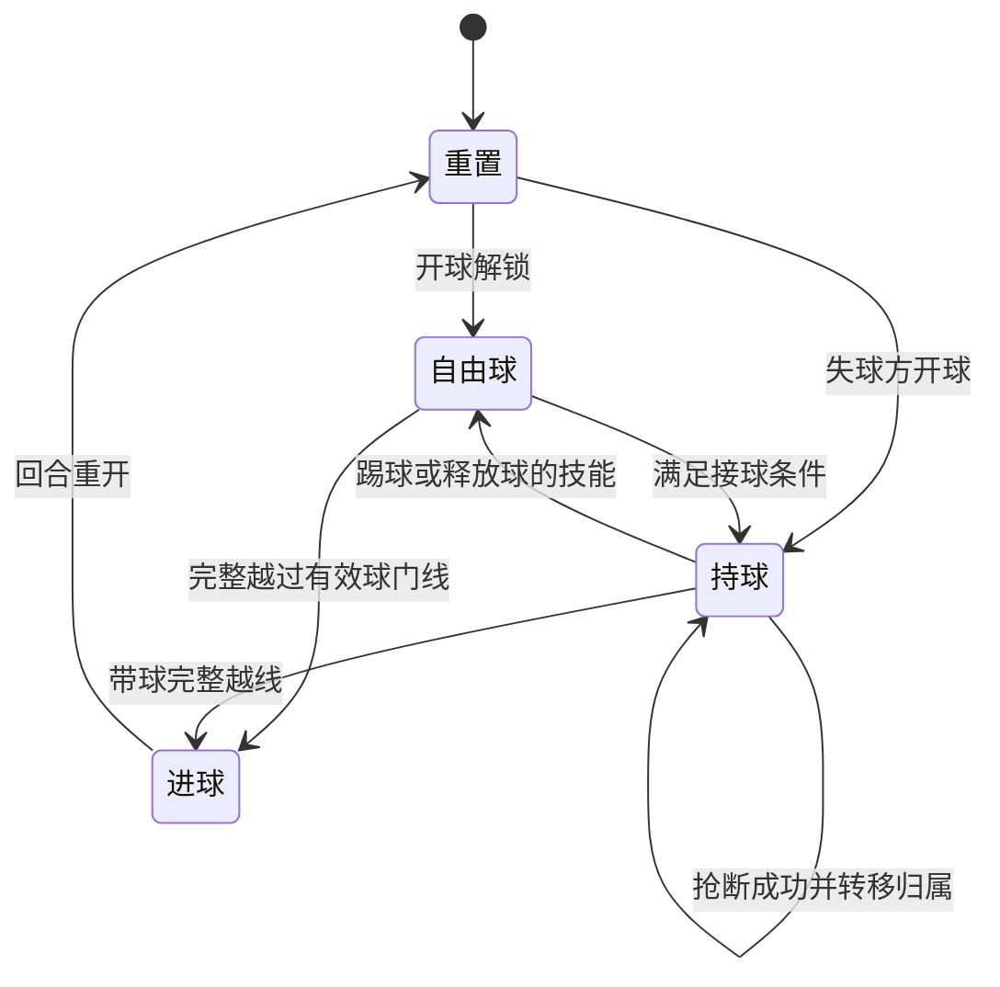
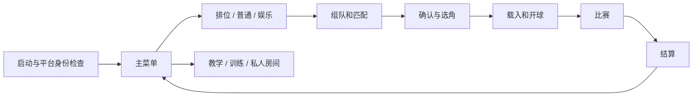
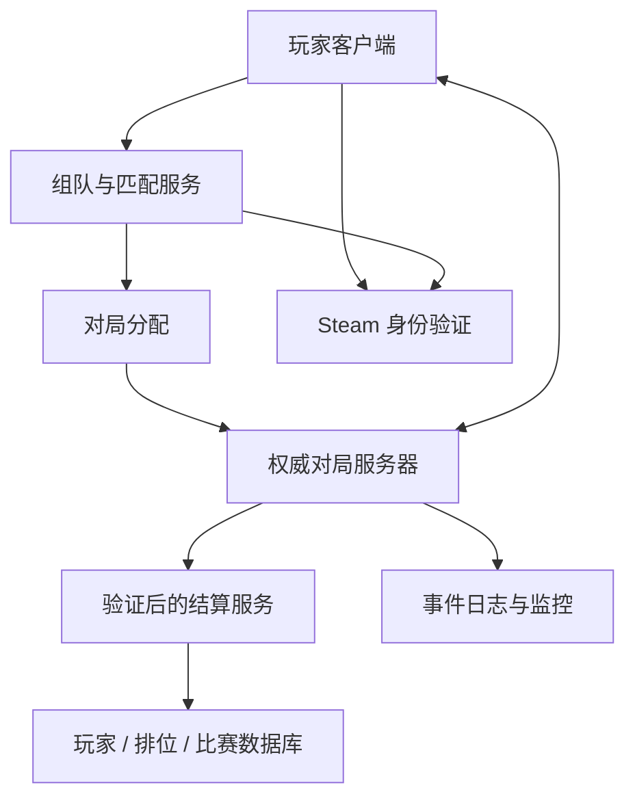

# 2D 技能足球游戏——项目设计文档

**文档版本：v0.10 · 无厘头角色与打击感原型 0.5**
**更新日期：2026 年 10 月 9 日**  
**项目代号：技能足球（正式名称待定）**  
**目标平台：优先 Steam / Windows PC；后续适配手机端，Android / iOS 范围待定**  
**当前阶段：以网络梗角色参考打磨武器、技能与合作对战，已有本地战斗原型**

> 本文覆盖玩法、角色、竞技与娱乐模式、联网、界面、内容范围和交付计划。用户已经明确的需求标为「已确定」；其余方案均为「建议」或「待确认」。所有具体数值均为初始设计假设，需在设计确认后的原型中验证，不能视为已完成平衡。
>
> v0.8 用户已授权开始项目，并要求 UI 与游戏逻辑写清楚以便后续开发。本轮先建立离线训练与三角 AI 对练；尚未确认的建议作为可调整的原型假设，不视为正式规则已冻结。工程说明见 [项目架构与开发指南](./项目架构与开发指南.md)、[UI 界面与交互说明](./UI界面与交互说明.md) 和 [验收与后续计划](./原型验收与后续计划.md)。

> **当前方向以 U23—U29 和第 7 章为准。** 以奶龙、东北雨姐、良子等熟悉形象作角色与技能参考，打磨接近荒野乱斗的舒适手感和无厘头合作乐趣；生命／能量／武器／击倒及 5 秒原地复活已接入。第 12 章的历史六人素材不作为新角色范围，其他章节的排位、发行与长期内容是后续规划。

## 0. 首轮评审导览

如果只先看最重要的内容，建议依次阅读：

1. **第 1 章**：检查游戏方向是否符合你的设想。
2. **第 3—6 章**：确认人数、操作、持球、踢球、45° 抢断与推人规则。
3. **第 7—9 章**：确认角色技能、排位和合家欢娱乐模式。
4. **第 16、18 章**：确认首发范围与开发启动条件。
5. **第 20 章**：逐项接受或修改待确认事项。

你可以直接使用「D04 改为……」「第 7.3 章奶龙参考打法改为……」来反馈。关键问题也单独整理在 [关键设计确认单](./关键设计确认单.md)。

## 1. 项目概述与需求边界

### 1.1 一句话定义

一款围绕进球目标展开的 2D 合作乱斗游戏：每名玩家操控一名带生命、能量和武器的角色，通过攻击、控制、保护、跑位与传球，为队伍创造进球机会。

### 1.2 已确定的需求

| 编号 | 用户已经明确的内容 | 设计影响 |
| --- | --- | --- |
| U01 | 2D 足球游戏，目标平台 Steam | 以 PC 联机体验作为项目主线 |
| U02 | 主要玩法参考《星际争霸 II》游戏大厅的「星际前锋」 | 重点参考一人一角、独特技能、传射与抢断的团队互动 |
| U03 | 每名玩家控制一名拥有独特技能的角色 | 不采用一人切换整支球队的控制方式 |
| U04 | 角色移动速度与体型不同 | 正式角色可有属性差异；当前先用相同身体验证装备与配合 |
| U05 | 球员能把球踢出一定距离 | 踢球具有有限距离，需定义力度、减速和角色差异 |
| U06 | 球员能向前短距离突进抢断 | 抢断必须包含位移、命中、方向和冷却规则 |
| U07 | 抢断与 45° 夹角有关，条件不满足时推动对方 | 需要精确定义角度参照、成功抢断与推人结果 |
| U08 | 有计分的排位 PVP | 需要排位分、匹配、结果验证、断线处理 |
| U09 | 匹配 PVP 包含普通匹配与合家欢娱乐 | 普通匹配采用排位规则，但不计排位分 |
| U10 | 娱乐模式技能和特效更戏剧性 | 同一角色应有可辨认的娱乐版本 |
| U11 | 先完成设计文档，确认细节后开发 | 玩法开发前评审设计；环境与资源准备授权见 U15 |
| U12 | 电脑端操作方案没有问题 | 确认第 4.1 章的键鼠操作方案，D05 电脑端部分已确认 |
| U13 | 手机端操作参考《荒野乱斗》的摇杆形式 | 补充横屏触控摇杆方案；具体按钮布局与辅助瞄准仍是设计建议 |
| U14 | 目前优先开发电脑端 | 当前首发与开发里程碑以 PC 为主，手机适配安排在后续阶段 |
| U15 | 根据设计文档准备环境、列出软件和平台，搜索并创作美术资源 | 已授权环境和资源准备；核心规则仍按确认单评审 |
| U16 | 美术采用未来城市运动联赛、清晰卡通手绘 2D | D14 已确认；本批资源先制作风格样稿和静态素材 |
| U17 | 使用 Unity 体系开发，并选择团结引擎编辑器配合已安装的 Tuanjie Cowork | 引擎路线已确认，使用 C#；安装后锁定具体编辑器版本 |
| U18 | 可自动安装其余工具；体积较大或难安装的软件由用户手动安装 | 已补齐 Git LFS、Unity／C# 编辑扩展与 .NET SDK；编辑器和构建模块列为手动项 |
| U19 | 美术更有趣；游戏避免完全俯视，人物和场景都应有轻微立体感 | D01 方向确认轻斜俯视；D14 补充活泼卡通 2.5D 表现，制作 v2 样稿 |
| U20 | 初稿美术可用；继续生成动画资源，让每个人物能跑步、转身、踢球等 | 六角各制作三套动作关键帧；保持已认可风格，生产动画与玩法接入仍待完成 |
| U21 | 跑步动作看起来像原地动，考虑从 8 帧补至 14 帧 | 六角重新绘制 14 帧跑步，加强收腿、过身、蹬地；增加行进预览与 8／14 帧对比 |
| U22 | 设计与初期美术已具备，可以开始项目；UI 和游戏逻辑应清楚，便于继续开发 | 建立 PC 离线三角原型，拆分规则、输入、表现和 UI，补充配置说明和开发指南 |

| U23 | 要非常有乐趣的合作对战，先打磨玩法 | 战斗与传球配合成为当前验证重点 |
| U24 | 每个角色有生命、能量和自己的武器，可攻击、眩晕或击倒对手 | 加入独立战斗系统与资源 HUD |
| U25 | 被击倒的玩家在原地用 5 秒恢复初始状态 | 原地满状态复活，保持掉球与倒地禁用规则 |
| U26 | 设计初期不先冻结英雄及外观 | 先验证打法，历史英雄草案归档 |
| U27 | 角色打击感参考荒野乱斗，要舒服 | 连续走位、快速前摇、短输入缓冲、清楚命中和输出空档 |
| U28 | 角色好玩、好笑、有戏谑与无厘头感 | 笑点通过弹肚、锅铲、饭团的战斗与团队配合发生 |
| U29 | 以良子、奶龙、东北雨姐等为模型，提供形象与技能参考 | 当前三种参考打法可玩；良子暂按大胃袋理解，画像与语音未接入 |

### 1.3 建议的体验目标

- 新玩家先学会移动、踢球、抢断，就可以参与一场比赛。
- 熟练玩家通过角度、时机、传球路线和技能协作形成上限。
- 进球依靠可理解的团队配合；防守失误能够被玩家识别和复盘。
- 竞技模式强调判定一致、信息清晰和可反制。
- 娱乐模式强调夸张互动与朋友同乐，仍然保留明确的球和比分。
- 角色养成和付费不提高竞技属性。

### 1.4 首轮建议摘要

| 项目 | 本稿默认建议 | 状态 |
| --- | --- | --- |
| 视角 | 轻斜俯视，人物和场景具有立体感；固定全场为预览提案 | D01 方向已确认；倾角与镜头范围待原型验证 |
| 主人数 | 3v3，每队 3 名真人球员 | 待确认 D02 |
| 门将 | 无固定门将席位，球员自行轮换防守 | 待确认 D03 |
| 电脑操作 | WASD＋鼠标，左键传射、右键普攻、空格抢断、Q/E 技能、C 取消 | 已确认 D05（电脑端） |
| 手机操作 | 参考《荒野乱斗》：左侧移动摇杆，右侧拖动瞄准与动作按钮 | 方向已确认；具体映射待确认 D21 |
| 开发顺序 | PC 优先，手机端后续适配 | 已确定 U14 |
| 45° | 突进方向与指向目标中心的方向夹角 ≤45°，即左右各 45° | 最高优先待确认 D04 |
| 持球 | 明确的持球归属，球在角色脚前随行 | 待确认 D06 |
| 技能配置 | 每角 1 个被动、2 个主动，无独立终极技能 | 待确认 D08 |
| 比赛 | 排位与普通匹配 5 分钟有效比赛时间 | 待确认 D10 |
| 场地 | 封闭边界反弹，无越位与常规犯规停哨 | 待确认 D07 |
| 当前角色 | 奶龙、雨姐、良子参考的三套可调打法＋玩法棋子 | 按 U29 更新参考方向，玩法与形象制作分步验证 |

上述未确认的方案是本稿讨论起点。已确认项会在评审记录中保留，后续如需变更再明确更新。

## 2. 参考玩法与本项目的取舍

### 2.1 已核对的参考方向

暴雪的官方介绍将 The Star Strikers 描述为足球题材的《星际争霸 II》大厅地图；官方韩文介绍列出了角色独特技能、抢断以及射门/传球的独立操作。此处仅据此确认参考方向，不将公开介绍当作当前地图版本的完整规则。[暴雪赛事介绍](https://news.blizzard.com/en-gb/article/14591236/the-star-strikers-world-championship)、[暴雪玩法介绍](https://news.blizzard.com/ko-kr/article/9864234/%EC%95%84%EC%BC%80%EC%9D%B4%EB%93%9C%2B%EC%B6%94%EC%B2%9C%2B%EA%B2%8C%EC%9E%84%3A%2B%EC%8A%A4%ED%83%80%2B%EC%8A%A4%ED%8A%B8%EB%9D%BC%EC%9D%B4%EC%BB%A4%EC%A6%88)

**45° 的具体含义未从官方公开介绍中得到确认。该要求来源于用户描述，本文将它作为本项目的独立规则讨论。** 如后续需要精准复现某一地图版本的手感，应以该版本的实机观察补充设计。

### 2.2 保留的设计核心

| 核心 | 本项目的体现 |
| --- | --- |
| 一人一角 | 每名玩家拥有持续的角色身份和场上责任 |
| 单球争夺 | 所有玩家围绕同一颗球形成攻守转换 |
| 角色差异 | 速度、体型、踢球距离、技能改变打法 |
| 短突进与推人 | 防守包含位移判断和空间控制 |
| 技能足球 | 技能改变传射机会，但比分仍通过进球产生 |

### 2.3 建议的原创方向

角色、名称、世界观、图像、声音和界面由本项目原创。**主题与美术方向已确认：未来城市运动联赛，活泼卡通手绘 2D，以轻斜俯视和体积光影呈现 2.5D 效果。** 运动员携带不同运动装置参加比赛，风格明快，允许竞技场和派对场共用角色。

角色暂用功能性代号。角色定稿、具体斜视倾角和动画制作范围仍需分别验证；本批样稿不等于全部正式游戏资源已完成。

## 3. 比赛结构与足球规则

### 3.1 队伍人数和场上职责

**建议主规格为 3v3。** 每队通常自然形成持球推进、侧翼接应、后场防守三种职责，职责由玩家动态轮换，不进行位置锁定。

这样可以先用 6 人验证传球和技能协作，也能减少新项目每场凑齐玩家的需求。如果你希望更接近人多混战的体验，可以在确认阶段直接改为 4v4 或 5v5；人数改变会同时影响球场、技能范围、镜头和匹配。

首发只维护一种公共队列人数。其他人数优先作为后续自定义房间选项，避免一开始增加多套平衡。

### 3.2 球场初始规格

定义 **1 u 为标准角色的身体直径**，所有数值使用逻辑单位，不直接绑定像素。

| 项目 | 初始建议 |
| --- | --- |
| 场内宽度 × 高度 | 32 u × 18 u，左右对攻 |
| 标准角色碰撞半径 | 0.50 u |
| 足球半径 | 0.18 u |
| 每侧球门净宽 | 4.5 u |
| 球门深度 | 1.5 u，计分后停止本回合 |
| 基准无球速度 | 5.0 u/s |
| 持球速度倍率 | 无球速度的 92% |
| 场地对称性 | 几何和功能严格左右对称 |

球场设中线、中心开球点、防守区域视觉标记和球门。防守区域首发不赋予额外属性，也不限制只有指定球员进入。

### 3.3 基础足球规则

| 规则 | 建议 |
| --- | --- |
| 进球 | 球的整个圆形越过球门线，且从有效门口进入，计 1 分 |
| 乌龙 | 正常计入另一队，结算不额外惩罚个人 |
| 带球入门 | 有效；持球球体仍须完整越线 |
| 越位 | 无 |
| 常规犯规、黄红牌 | 无；推人作为合法动作，通过冷却和保护限制强度 |
| 出界 | 边线和球门之外的底线为反弹边界 |
| 门柱 | 真实碰撞，球可反弹；高速球也必须准确判定 |
| 同队身体碰撞 | 弱分离，避免完全重叠；不会把队友锁死在角落 |
| 敌队身体碰撞 | 阻挡和分离；普通走路相撞不主动触发推人或抢断 |
| 玩家出场地 | 不允许；推力遇到边界停止，不发生跌落死亡 |
| 角色死亡 | 有生命、伤害与击倒；掉球，5 秒后原地满状态恢复 |

### 3.4 开球、进球重置与时钟

1. 开局双方回到本方出生区域，足球位于中点。
2. 3 秒倒计时后解锁移动和技能，双方公平争球。
3. 有效比赛时间只在可行动状态下流逝。
4. 进球后展示约 2 秒庆祝，双方重新布阵。
5. 失球方获得中线本方一侧的开球归属；双方位于各自半场。
6. 重开倒计时 2 秒，解锁后存活开球者有 1 秒保护；攻击、踢球、抢断、使用技能或越过中线提前结束保护。失球队全倒地时球在中点自由争夺。
7. 重置清除场上弹体和技能物，存活者恢复资源和冷却；倒地者保留原坐标与剩余复活时间，继续完成 5 秒等待。

「保护」期间不能被抢断和推移，但不允许利用保护使用技能或深入敌方。开球者由队内就近出生槽轮换，避免固定由某人包办。

### 3.5 时长、平局与加时

- 排位、普通匹配：5 分钟有效比赛时间，无半场换边；设计对称性和视觉公平需验收。
- 合家欢：4 分钟有效比赛时间。
- 排位与普通匹配平局：均进行最多 90 秒金球加时，先入球者获胜；仍无进球则记平局。普通匹配只是不修改排位分，比赛规则保持一致。
- 娱乐平局：30 秒金球加时，仍平局则并列结束。
- 主时钟或加时结束时，以服务器截止时刻前已经成立的进球为准；不设置无限延长的「最后一次进攻」。

首发不设计点球决胜。若用户希望排位必须分胜负，可另行评审限时点球或其他决胜规则。

## 4. 操作、移动与镜头

### 4.1 电脑端默认键位（0.4 加入独立普攻）

沿用已认可的键鼠操作，在 0.4 中加入独立武器普攻：右键攻击，取消移到 C。其余战斗数值继续通过试玩调整。

| 操作 | 键鼠默认 | 行为 |
| --- | --- | --- |
| 移动 | WASD | 八向输入，斜向速度归一化 |
| 瞄准 | 鼠标位置 | 面朝角色到鼠标的方向 |
| 踢球 | 鼠标左键按住后松开 | 点按短传，蓄力远传或射门 |
| 突进抢断 | 空格 | 沿瞄准方向短距离突进 |
| 主动技能 1 / 2 | Q / E | 按角色技能说明施放 |
| 武器普攻 | 鼠标右键点按／按住 | 瞄准攻击敌人，按间隔连发 |
| 取消蓄力/待发普攻 | C | 取消尚未提交的动作，不额外踢出球 |
| 快捷交流 | 鼠标中键或 G | 标记接应、防守、传球需求 |
| 计分板 | Tab | 查看比分、队伍和网络状态 |
| 菜单 | Esc | 设置、退出提示，不暂停联机比赛 |

支持按键重绑定、鼠标灵敏度调节。鼠标位于角色中心附近时保留上一有效朝向，避免零向量和方向抖动。

电脑端按已确认的 WASD＋鼠标方案推进，不再把点击地面移动列为当前默认备选。

### 4.2 移动和朝向

- 移动方向与瞄准方向可以不同，允许横移、后撤和护球。
- 无球基准速度为 5.0 u/s，角色各有差异。
- 加速与减速采用短过渡，初始建议 0.08 秒到达目标速度。
- 瞄准转向速度初始上限 720°/s，避免持球瞬间转身导致足球跨越角色身体。
- 普通移动不能把敌人的持球归属直接夺走；需要成功抢断、相关技能或接到自由球。
- 首发不增加独立体力条；通用突进由冷却限制。

### 4.3 镜头与屏幕比例

建议固定全场镜头，让玩家一直知道球、队友、对手和两个球门的位置。

- 16:9 为构图基准；不同宽高比显示相同的有效球场。
- 超宽屏增加外围装饰区域，不增加竞技视野。
- 小尺寸界面通过字号和图标缩放适配。
- 本地角色始终具有专属轮廓和脚下识别圈。
- 娱乐模式震屏可以关闭，不影响实际判定。

### 4.4 手柄与本地同屏

手柄可采用左摇杆移动、右摇杆瞄准、肩键踢球/抢断，Q/E 对应扳机或面键。是否首发支持待确认。

**「合家欢娱乐模式」默认指联机玩法风格。** 本地多人同屏、Steam Remote Play Together、多个手柄玩家共用一台电脑属于额外平台与输入功能，尚未被用户明确要求，不纳入默认首发范围。

### 4.5 手机端操作方向与开发优先级

**已确定：手机端参考《荒野乱斗》的摇杆操作形式；当前优先开发电脑端。** 以下是将该方向映射到技能足球的建议方案，具体触控细节尚待确认。

手机端采用横屏：左拇指移动，右拇指负责方向瞄准、踢球、抢断和技能。借鉴拖动瞄准、松手执行以及紧凑的动作按钮布局；蓄力、球权和抢断仍按照本游戏规则定义。

控制布局也建议支持位置与大小调整。《荒野乱斗》官方曾说明其加入可自定义控制设置；本项目是否以及如何实现，以后续手机适配范围为准。[Supercell 自定义控制说明](https://supercell.com/en/games/brawlstars/blog/release-notes/optional-update-customizable-controls/)

手机端不纳入当前 PC 首发必备，也不作为当前阶段的开发或验收前置条件。PC 核心玩法、联机和体验完成验证后，再安排手机触控原型、性能适配与发行平台确认。

### 4.6 手机端动作映射草案

| 动作 | 触控操作建议 | 与电脑端的对应关系 |
| --- | --- | --- |
| 移动 | 左下虚拟摇杆；拖动决定方向，幅度可调节移动速度 | 输出移动向量，最大速度遵守同一角色属性 |
| 传球 / 射门 | 持球时按住右侧大按钮，拖动瞄准，松手踢球 | 对应鼠标左键蓄力与松开；力度由按住时间决定，不由拖动长度决定 |
| 短传 | 快速点按踢球按钮，沿当前有效朝向踢出 | 对应电脑端点按踢球，不自动寻找队友或球门 |
| 突进抢断 | 抢断按钮可拖动选方向，松手启动；点按使用当前有效朝向 | 对应空格；实际接触和最终确认的 45° 规则不变 |
| 方向型技能 | 从对应技能按钮拖动，显示方向与范围，松手施放 | 对应 Q/E 的方向输入；冷却、前摇和作用范围不变 |
| 地点型技能 | 拖动技能按钮选择范围内落点，松手施放 | 映射为球场坐标，显示真实作用区域 |
| 队友目标技能 | 拖动选择符合范围与角度条件的队友，松手确认 | 沿用同一候选目标规则，没有合法目标时不施放 |
| 无需目标的技能 | 点按技能按钮启动 | 对应即时 Q/E 技能 |
| 取消动作预选 | 将动作拖至明确的取消区，再松手 | 对应右键取消；不踢球、不释放技能 |
| 快捷交流 / 菜单 | 顶部或边侧小按钮 | 不覆盖主要摇杆区域，联机菜单不暂停比赛 |

瞄准拖动以按钮起始触点为中心转换为方向，不把手指所在屏幕位置直接当作远处目标。地点型技能则把拖动幅度映射到合法施法距离；按钮旁与球场上同步显示目标预览。

踢球力度仍采用第 5.4 章的时间曲线：点按短传、持续按住蓄力、0.85 秒达到普通满蓄力；达到满蓄力后最多保持 0.5 秒再自动踢出。特殊技能按各自说明覆盖。拖动超过摇杆范围只改变方向，不继续增加力度或射程。

按住无球踢球按钮只能调整瞄准，不预先排队一脚等待将来拾球；如果随后获得球，需要重新按下再蓄力。蓄力中失去球权，待发踢球取消。规则与第 5.4 章一致，避免触控产生额外自动出脚优势。

没有有效拖动方向时，点按使用当前保留的角色朝向。角色尚未取得任何有效瞄准输入时，初始朝向为对方球门方向；移动不强制覆盖已经设置的瞄准方向，仍允许横移与后撤。

**自动瞄准、自动传最近队友、自动射门不列入已确认需求。** 本稿先按手动方向方案预留；是否增加辅助及其适用模式，在手机原型阶段单独确认，不直接改变竞技规则。

### 4.7 手机触控布局与体验要求

- 左下放移动摇杆；右下放最大的踢球按钮，邻近放抢断，Q/E 两个技能按钮排在其上方。
- 支持移动与一个右侧动作同时进行，不要求玩家用第三根手指才能完成普通移动传射。
- 每个触点绑定一个控件；手指滑过其他按钮不能误触发技能，换动作前先取消未完成的预选。
- 系统中断、触点取消或进入后台时，取消尚未执行的蓄力/技能、清零移动输入；网络状态再按断线规则处理。
- 提供摇杆大小、位置、固定/浮动方式、左右手布局等可配置选项；具体选项优先级由后续适配范围确定。
- 按钮避开安全区域、系统手势区域和球门，不让拖尾或队伍提示被手指长期挡住。
- 手机显示与 PC 相同的有效球场；用界面缩放和外围留白适配屏幕比例，不增加或裁掉竞技视野。
- 手机字体、技能冷却、球体轮廓和蓄力反馈单独适配，娱乐模式保持球的可见性。

### 4.8 跨端玩法与匹配边界

电脑和手机计划共享角色定义、球权、冷却、进球及最终确认的抢断规则；输入设备只负责提交移动、瞄准和动作意图。

PC 与手机是否共用账号进度、好友系统、排位和匹配池均未确认。后续先在手机测试环境验证手感、网络与性能，再决定是否允许跨端组队和匹配。当前电脑端开发不依赖这些决策。

如果未来开放跨端竞技，还需验证摇杆方向精度、触控遮挡和辅助瞄准是否影响公平性；相关结果决定混合匹配或按输入方式分组，不能仅凭共用服务器就认定体验一致。

## 5. 足球、持球、传球与射门

### 5.1 足球状态



足球同一时刻只允许一名持球者。自由球记录速度、旋转表现、最后触球者与最后所属队伍。所有会改变球速或轨迹的技能，必须在技能说明中定义是否释放持球。

### 5.2 持球方案

**建议：有明确归属的脚前随行持球。** 球位于角色瞄准方向的脚前偏移点，偏移距离为角色半径＋足球半径＋0.05 u。

这样持球者、传球对象和抢断目标比较明确，也有利于把「45° 抢断」变成可教学的规则。

持球期间：

- 球与角色一起移动，持球移速降低 8%。
- 球的表现跟随朝向平滑变化，不能穿过墙、门柱或生成的球体障碍。
- 若脚前位置与障碍重叠，先缩短持球偏移；仍无法放置，则在最近合法位置释放为自由球。
- 身体接触不会自行转移球权，持球显示不制造可被反复自动抢回的假自由球。
- 推人成功时，持球者与球一起位移，原则上保留球权。
- 球体仍参与球门越线判定，因此可以带球进门。

另一可选方案是「球始终自由滚动，靠近时短暂控球」。它更强调连续触球，也会显著改变抢断、射门和网络预测。两者需在开发前选定。

### 5.3 接自由球

| 自由球速度 | 角色接触后的建议结果 |
| --- | --- |
| ≤10 u/s | 满足资格时直接接住并进入持球 |
| >10 u/s | 身体挡球并反弹或降速，不能直接自动吸住 |
| 使用专门接球/拦截技能 | 根据技能规则截停或改向 |

接球范围以身体半径＋球半径计算，不额外附赠大吸球圈。初始建议踢出者 0.25 秒内不能重新拾取自己踢出的球，防止贴身点按无限自传；其他人仍可正常接球。

高速球身体反弹系数初始 0.45；边界反弹系数初始 0.75。反弹后可以变成可接的低速球。无球运动员也能守门，但无法无条件吸住所有高速射门。

多个玩家同时够到球时，依据真实最早接触时刻判断；完全同刻按固定、可复现的裁决顺序处理，出生槽每回合轮换，避免固定槽长期占优。

### 5.4 踢球力度和距离

建议把传球和射门合并为同一个踢球动作，由力度、方向和场上位置区分。

| 蓄力 | 基准初速 | 平地无碰撞理论滚动距离 | 用途 |
| --- | --- | --- | --- |
| 点按，约 0—0.12 秒 | 9 u/s | 约 5.1 u | 短传与小幅拨球 |
| 中等蓄力，约 0.4 秒 | 13.5 u/s | 约 11.4 u | 中距离传球、射门 |
| 满蓄力，0.85 秒 | 18 u/s | 约 20.3 u | 远传、强力射门 |

球采用近似恒定减速，初值 8 u/s²。表中距离按 `距离 = 初速² ÷ (2 × 减速度)` 估算；碰撞、角色踢距系数和技能会改变结果。

角色「踢距系数 k」修改的是理论滚动距离；初速按基准初速乘以 `√k` 计算，避免把距离系数误用为速度系数后放大两次。

- 蓄力时移速为当前持球速度的 80%，有明确姿态和蓄力条。
- 满蓄力后继续按住最多保持 0.5 秒，再自动踢出，避免无限持球蓄力。
- 无球时踢球不攻击角色，不自动蓄力等待很久以后拾球。
- 球释放后有 0.18 秒动作间隔，不能再次踢球或启动主动技能。
- 暂不加入挑射、跳跃、球的真实高度和头球；特殊轨迹通过 2D 曲线完成。

### 5.5 球权和球事件的优先级

同一模拟步先收集输入并更新动作状态，再按连续接触发生的时间顺序处理：物理接触、抢断或技能命中、球权变化、有效进球。

对于完全相同接触时刻的冲突，固定顺序为：阻挡/球门口几何 → 有效保护效果 → 主动抢断或球技能 → 普通接球。球完整越线一旦成立，立即锁定进球，不允许随后发生的抢断将比分取消。

取消蓄力先于同帧松开键生效。服务器记录规则版本和裁决事件，避免客户端各自决定顺序。

## 6. 短突进、45° 抢断与推人

### 6.1 通用突进动作

所有角色拥有同一类基础抢断，不需要解锁或消耗角色技能槽。

| 参数 | 初始建议 |
| --- | --- |
| 突进距离 | 1.8 u |
| 动作前摇 | 0.06 秒 |
| 突进持续时间 | 0.15 秒 |
| 空挥后摇 | 0.15 秒 |
| 基础冷却 | 2.8 秒，从动作启动时计算 |
| 方向 | 输入时的瞄准方向，动作期间锁定 |
| 命中数量 | 第一个有效敌方身体目标，最多 1 人 |
| 地形交互 | 不穿墙、不穿门柱；接触有效目标后结束突进 |

己方角色不消耗一次抢断命中，突进仍遵守身体弱分离。自由球不会变成「被抢断角色」，按照接球规则处理。

持球时也能使用通用突进：可以用于推进或推开无球对手，但这不是无敌动作，被另一人的有效抢断命中仍会丢球。

### 6.2 45° 规则的歧义与本稿假设

用户说的「45° 夹角」至少可能对应以下三种规则：

| 解释 | 判定方式 | 体验影响 |
| --- | --- | --- |
| A：夹角上限 45° | 突进方向与指向目标中心的方向夹角 ≤45° | 攻击者需对准目标，完整扇形为 90° |
| B：完整扇形 45° | 中心方向两侧各 22.5° | 更严格，擦边命中更常成为推人 |
| C：以持球者朝向为参照 | 检查进攻来自持球者的正面、侧面或背面 | 护球和转身会成为抢断判断的关键 |

**本稿暂用 A，等待用户确认。** 目标面朝哪里不影响 A 的判定。若选 C，还须明确是允许正面、背面还是球所在一侧的 45° 范围。

### 6.3 建议采用的精确定义

设：

- `d`：抢断启动时锁定的单位突进方向。
- `pA`：发生首次有效接触时，抢断者的中心位置。
- `pB`：同一时刻，被撞角色的中心位置。
- `r = normalize(pB - pA)`：从抢断者指向目标中心的方向。
- `θ = arccos(clamp(dot(d, r), -1, 1))`。

在**实际身体接触成立**后，若 `θ ≤45°`，并且目标持球且没有有效保护，则触发成功抢断；若角度不满足，则触发推人并保留目标球权。

45° 只定义抢断与推人的分支，不额外扩大身体碰撞范围。位于角度范围内但没有撞到目标，不会远程夺球。位置恰好重合时，使用该接触的上一合法相对方向，避免零向量导致判定不稳定。

```text
                    有效方向上边界（+45°）
                   /
                  /   已实际碰撞的目标，才检查此角度
抢断者 A  ● ----->    突进方向 d
                  \
                   \
                    有效方向下边界（-45°）

本稿：左右各 45°，两条边界之间合计 90°。
```

### 6.4 命中结果表

| 目标与状态 | 结果 |
| --- | --- |
| 持球敌人，角度合格，无保护 | 球权立即转给抢断者；目标进入短硬直 |
| 持球敌人，角度不合格，无保护 | 目标沿突进方向被推动，保留球权 |
| 无球敌人，无保护 | 推动目标，不生成球权 |
| 目标有完整接触保护 | 不抢断、不推人；攻击者本次动作与冷却照常消耗 |
| 目标只有防重复夺球保护，角度合格 | 不转移球权，也不改判为推人；攻击者消耗动作与冷却 |
| 目标只有防重复夺球保护，角度不合格 | 按普通侧撞推移处理，不转移球权 |
| 目标只有重复硬控保护 | 可被合法抢断，但本次不附加硬直；侧撞不产生推移 |
| 目标只有推移抗性 | 抢断仍有效，只降低推人位移 |
| 没碰到敌人 | 空挥，进入后摇和冷却 |
| 双方同时抢断同一持球者 | 最早有效接触者成功；完全同刻按固定裁决顺序 |
| 同时撞击的双方均持球？ | 系统禁止同时存在两个持球者，因此该状态非法 |

### 6.5 抢断成功后的结果

- 不额外推动失球者，避免一次动作同时给出最大夺球和位移收益。
- 失球者有 0.18 秒行动硬直，随后获得 0.6 秒重复硬控保护。
- 新持球者获得 0.2 秒防重复夺球保护，踢球仍可立即进行；该保护不能防止球已经踢出后的拦截。
- 被抢断后获得的硬控保护只限制硬直和推移，不阻止后续正常球权争夺。
- 不自动朝球门转向，不自动完成射门。

### 6.6 推人、体型与连续控制

- 基准推移距离 0.9 u，持续约 0.18 秒。
- 推移方向使用抢断锁定方向 `d`，不由客户端自行选择。
- 体型大的角色通过独立「推移抗性」参数降低位移，碰撞半径本身不自动加算抗性。
- 推移抗性上限初始为 60%；可以被抢断，不存在常驻免疫球权丢失的重型角色。
- 成功推移后目标获得 0.6 秒重复硬控保护，期间后续推移和硬直被忽略，但正常接球和有效抢断仍可发生。
- 推移会中断蓄力；达到边界时提前停止，不累积出场外力。
- 所有角色受同一连续控制保护约束，娱乐模式也不允许无限连推。

### 6.7 教学和调试需求

训练场可显示突进方向、±45° 边界、首次碰撞点和实际 θ，反馈「抢断成功」「侧撞推移」「未碰到目标」「保护中」四类结果。

竞技实战只保留短提示和清晰动画，不在球场上持续显示计算公式。测试至少覆盖 44°、45°、46°、擦边碰撞、大体型目标、同时抢断和高延迟。

## 7. 角色、武器与合作战斗

### 7.1 当前方向（U23—U29）

先打磨有趣的合作对战。每个玩家具有生命、能量、自己的武器和技能，可以攻击、眩晕或击倒对手。击倒者在原地等待 **5 秒** 后恢复初始状态。以奶龙、东北雨姐、良子等熟悉形象作为可调整的角色参考，技能由性格、动作和梗特点推导。手感参考荒野乱斗；当前使用玩法棋子，对应画像、语音和动画未接入。

### 7.2 生命、能量与恢复

测试采用 100 生命／100 能量，普攻无能量消耗，Q/E 同时受能量和冷却限制。消耗后 1.25 秒开始每秒恢复 12 能量。被击倒立即掉球、停止行动与碰撞，5 秒后在原坐标满资源、清控制并刷新冷却；暂用 1 秒复活保护，主动行动提前结束。进球不提前复活倒地者，复活等待在庆祝和倒计时中继续。

### 7.3 三套无厘头角色参考打法

奶龙参考采用肚皮弹锤、可弹墙一次的弹肚波和 Duang护罩；雨姐参考采用锅铲三连、短距离宽锅气劲与开工提速；良子参考采用饭团远投、扇形饭团控制与开席治疗，暂按大胃袋良子理解。三套共享基础身体属性，普攻三格储备并逐格补充；可以边走边打，普攻前摇 50—60 ms，点按短缓冲 120 ms。已接入出手回弹、受击闪白／局部压缩、合并伤害浮字及对应短音。完整数值与边界见 [合作乱斗玩法原型 0.5](./合作乱斗玩法原型.md)，角色梗、配合例子与试玩标准见 [角色趣味与打击感](./角色趣味与打击感.md)。

### 7.4 对抗与配合

目前进球决定胜负、击倒只创造人数优势，作为测试假设。低血持球者应能交球撤离，队友可用护盾接应、眩晕开路或治疗维持推进。队友不受武器伤害；治疗不复活；硬控结束后有 0.6 秒控制保护。持续观察原地复活守尸、远程压制、连续全队倒地和忽略足球互殴的情况。

### 7.5 内容决策顺序

先用熟悉的角色参考验证武器手感、无厘头互动、配合与 5 秒恢复窗口；真人合作验证后确定正式角色范围、技能组合和对应形象制作。既有角色／动画素材保留；[旧六人草案](./历史角色草案.md) 已归档，不再作为首发清单。

## 8. 排位 PVP 与普通匹配 PVP

### 8.1 模式结构

| 项目 | 排位 | 普通匹配 | 合家欢娱乐 |
| --- | --- | --- | --- |
| 公共队列人数 | 3v3 | 3v3 | 3v3 |
| 基础规则 | 竞技规则 | 与排位完全相同 | 娱乐规则覆盖 |
| 技能配置 | 竞技配置 | 同一竞技配置 | 娱乐配置 |
| 可见排位分 | 影响 | 不影响 | 不影响 |
| 隐藏实力评估 | 排位专用 | 普通匹配专用 | 娱乐专用，权重较低 |
| 同队重复角色 | 不允许 | 不允许 | 允许 |
| 公共队列机器人 | 不允许 | 默认不允许 | 经明确标识，可补位 |
| 主要用途 | 公平竞技、赛季目标 | 练习角色、轻松打标准规则 | 朋友同乐、夸张技能 |

普通匹配虽然不计排位分，仍然评估自身隐藏实力以尽量避免悬殊对局。三个模式的结果不会交叉更改排位分。

### 8.2 组队和匹配

- 可单人、双人或三人组队。
- 优先匹配相近延迟、相近实力、相近组队结构。
- 三人队优先对三人队；等待变长时允许放宽，但把组队协作优势计入预期胜率。
- 首发使用一套排位，记录组队信息；不额外拆分单排和组排榜。
- 预计 0—30 秒使用较严格实力窗口，30—90 秒逐步放宽，超过 90 秒显示等待状态和其他模式入口。
- 排位不为了凑人自动填机器人，也不自动切换为普通或娱乐比赛。
- 网络阈值初步以 RTT ≤120 ms 为首选，排位初始硬上限 180 ms；真实阈值由联机测试确定。
- 不自动跨越玩家设置的服务器区域或延迟上限。

### 8.3 选角流程

匹配成功 → 15 秒确认进入 → 30 秒选角 → 双方阵容公开 → 5 秒载入缓冲 → 开球倒计时。

- 选角允许队内预选，先锁定者占用角色。
- 双方同时选角，不提前显示敌方选择，锁定完成后同时揭示。
- 原型先选测试装备，验证不同组合；正式英雄及禁选流程留待玩法稳定后决定。
- 超时自动选择该玩家最近使用且队内未重复的角色；没有记录时选择可用的新手推荐角色。
- 比赛中不能更换角色。
- 选角退出整场取消，其他人保留优先匹配资格；重复退出者进入短队列冷却。

### 8.4 排位分与段位草案

建议采用可解释的团队胜负评分模型：每人拥有排位实力值和不确定度，队伍实力结合成员水平及组队因素计算预期胜率。

初始展示模型可写为 `分数变化 = K ×（实际结果 − 预期胜率）`：胜利 1、平局 0.5、失败 0；K 随定位状态和不确定度变化。正式实现前确定完整算法，初稿不承诺固定「每局加减 20 分」。

- 完成教学并打完 10 场普通匹配后可进入排位。
- 首个赛季前 5 场为定位，定位局仍正常匹配和记录结果。
- 段位名称初定：青铜、白银、黄金、铂金、钻石、大师。
- 段位阈值、晋降级缓冲与榜单人数在真实测试分布出来后确定。
- 不按进球数或助攻数额外加分，避免玩家拒绝传球或放弃防守。
- 赛季长度初定 8—12 周；每季软重置，奖励以外观为主。
- 不以个人角色熟练度替代整体排位；熟练度仅展示和提供外观进度。

### 8.5 断线、重连、掉线队伍与投降

| 情况 | 处理建议 |
| --- | --- |
| 开球前有人未成功连接 | 取消比赛，所有人不计分，异常退出方记录队列冷却 |
| 比赛中掉线 | 角色停止移动，不放入排位 AI；若持球，立即释放为自由球 |
| 原玩家重连 | 60 秒内恢复原角色与当前比赛状态，不能刷新技能冷却 |
| 排位缺员持续超过 60 秒 | 其余队员可离开而不追加逃跑处罚；正常败局仍计分 |
| 排位主动退出且不回归 | 按正常败局结算并记录逃跑；处罚逐次升级，不承诺额外扣分叠加 |
| 普通/娱乐掉线 | 同样优先重连；娱乐可在重连窗口结束后用明确标识 AI 补位 |
| 新真人中途加入 | 首发公共队列不支持；自定义房间后续再评审 |
| 服务器故障或结果不完整 | 整局不计排位，留下诊断记录，禁止由客户端自行补写结果 |

不因单人主动退出自动免除队伍败局，避免利用退出来回避输局。可另行设计经服务器确认的服务故障补偿。

投降需比赛已进行 2 分钟，且所有仍连接的队员同意；只有一人剩余并已超过重连窗口时可独自投降。竞技中的暂停首发不提供。

### 8.6 反消极与交流

- 初始 30 秒无有效操作显示提示，60 秒触发消极标记；纯重复按键不会视作真实参与。
- 综合移动、接应位置和球交互，避免把后场守门者误判为挂机。
- 同时提供举报、屏蔽和快捷交流限频。
- 首发默认快捷标记和预设短语；自由文字聊天、语音聊天另行确认，避免把社交系统变成前期主工程。

## 9. 合家欢娱乐模式

### 9.1 模式目标

在基础传射和抢断仍然成立的前提下，扩大技能表现和可笑的物理互动。玩家依旧能看清足球、知道自己为何失球、理解比分。

娱乐不是把全部数值统一乘二；第 7 章已经给每个角色定义了可辨认的娱乐版本。基础 45° 判定默认保留，避免切换模式后重新学习抢断。

### 9.2 娱乐基础覆盖

| 项目 | 初始建议 |
| --- | --- |
| 比赛时间 | 4 分钟 |
| 同队重复角色 | 允许 |
| 通用抢断冷却 | 2.3 秒 |
| 通用推移距离 | 1.2 u |
| 重复硬控保护 | 至少 0.6 秒，和竞技一样保留 |
| 技能表现 | 彩色拖尾、漫画爆字、残影、泡泡和夸张音效 |
| 足球数量 | 首发保持 1 颗真实可计分足球 |
| 机器人 | 可以明确标识补位，结果不计排位 |
| 随机事件 | 只在娱乐发生，同一时刻最多 1 个 |

### 9.3 首发三种球场事件草案

首次事件在比赛有效时间 45 秒出现，此后每 45 秒抽取一次；上次事件未结束则延后。事件前 3 秒全场预告，单次约 10 秒。双方受到同样规则影响。

| 事件 | 规则 | 可读性与公平边界 |
| --- | --- | --- |
| 弹力边界 | 边界反弹系数暂从 0.75 提高至 0.95 | 球门不变，边界显示弹簧纹理；不加球速 |
| 巨型足球 | 球半径变为 0.27 u，其他运动参数不变 | 进球仍需完整越线；体型渐变中避免生成重叠，必要时延期触发 |
| 顺风跑道 | 上下两条对称边路各出现加速区域，球员移速增益 15% | 两队同样受益；与技能加速取最大值，不影响球 |

事件由服务器使用当局种子抽取，首轮避免连续同一事件，进球重置会清除当前事件，计时继续按有效比赛时间推进。加时不触发新事件。

### 9.4 戏剧性特效的边界

- 球的中心标记和轮廓永远可见；拖尾不是第二颗球。
- 大特效使用透明度、描边和分层，不能遮住球门和输入反馈。
- 特效可以夸张，实际碰撞范围必须与场上提示对应。
- 震屏、闪烁和强烈效果可关闭，关闭后仍保留关键预警。
- 首发不加入得分翻倍、多球、真假足球、全场传送门或随机瞬间换位；这些需要单独验证，不能一次叠入娱乐模式。

### 9.5 和朋友一起玩的入口

娱乐公共匹配支持 1—3 人组队。私人房间允许最多 6 名真人自由分队，选择竞技或娱乐规则，并可设置是否允许 AI 补位。

私人房间不计任何排位分，也不作为公开匹配胜率统计。若确认需要本地同屏，应增加独立的控制、账户归属和联机混合方案。

## 10. 单局流程、主菜单与界面

### 10.1 主流程



首次启动引导学习基础操作；之后直接进入主菜单，可以随时重开教学。

### 10.2 主菜单

主入口：开始比赛、邀请好友、私人房间、训练、角色图鉴、个人资料、设置。

模式选择清晰展示是否计排位分、人数、预计局长和当前队伍人数。低活跃时展示哪些模式目前开放，不制造不存在的「预计 10 秒匹配」。

首发默认不要求额外注册游戏账号；Steam 身份与后端玩家记录关联。是否需要其他平台账户在跨平台阶段再评审。

### 10.3 比赛 HUD

- 顶部：比分、剩余有效时间、模式、加时状态。
- 底部：通用抢断、Q/E 技能图标和剩余冷却。
- 角色附近：本地识别圈、蓄力条、持球提示、关键保护状态。
- 足球：固定轮廓、中心标记和必要的轨迹提示。
- 边缘：队伍标记、快捷交流和可展开的网络状态。
- 娱乐事件：名称、规则短句、剩余时间，不覆盖球场中心。

显示生命、能量、护盾、眩晕和复活倒计时；普攻与技能有冷却及能量不足反馈。阵营使用颜色＋形状编码。

### 10.4 结算

展示胜负、比分、角色、比赛时长、排位变化（排位专有）及若干贡献：进球、助攻、有效抢断、传球和扑救。

- 助攻初始定义：进球前 3 秒内最近一次有效队友传球，期间未被敌人持有。
- 扑救初始定义：挡住沿当前轨迹将进入本方球门的球，并使其未进球；同一射门不重复计数。
- 「贡献」不直接改变排位分，只用于反馈与复盘。
- 可再次组队排队、返回主菜单、屏蔽或举报。
- 公开完整回放不是默认首发功能；服务器事件记录先用于排查判定。

## 11. 新手教学、训练与 AI

### 11.1 教学分为五步

1. 移动、瞄准、识别本地角色。
2. 接球、点按传球、蓄力射门。
3. 45° 成功抢断、侧撞推人及冷却。
4. Q/E 技能与对手的预警和反制。
5. 和简单 AI 队友完成一次传球与进球配合。

每步提供明确的完成条件和重新尝试机会，训练中可开启判定可视化。初次教学目标控制在约 5 分钟，正式时长由实际测试决定。

### 11.2 训练场

支持单人移动射门、静止和移动目标、角度显示、技能冷却重置、球复位、角色切换，以及网络无关的基础手感检查。

训练也使用同一套模拟规则和数值；开发者便利功能不进入公共比赛。

### 11.3 AI 范围

首发 AI 用于教学、私人训练和娱乐缺员补位。只要求完成基本防守、接球、传射和有限技能操作，不承诺竞技级对手。

AI 不读取玩家未公开的鼠标输入或未来技能，不瞬间完美抢断。机器人名称有明确标记，不伪装真人，不进入排位。

## 12. 美术、动画、特效和声音

### 12.1 美术方向

**当前场景保留未来城市球场与轻斜俯视的 2.5D 表现，角色方向按 U29 更新为熟悉网络形象的无厘头乱斗参考。** 下列资源范围中的历史六人计划待玩法验证后重新评估。角色可通过夸张动作与轮廓表达性格；场景通过座椅、花池、围栏、球门的厚度及独立落地阴影体现高低层次。既有场景样稿见 [美术资源准备](./美术资源准备.md) 和 [资源图库](../previews/art-gallery.html)。

本批预览采用正交相机与约 55° 对水平地面的俯角，地面纵向投影约为原长的 82%，左右球门保持平行；固定全场、具体倾角与角色显示尺寸仍为原型参数。人物 PNG 的倾角为近似绘制，尚未完成精确相机标定。逻辑坐标、碰撞半径和技能范围保持独立，在预览中将地面圆形投影成椭圆；美术轮廓与画面压缩不改变玩法判定。

角色透明 PNG、脚底阴影、队伍标记、球场线与球门分层保存；同一光照方向为上左暖光。按地面脚点而非图片中心确定前后遮挡；不通过旋转单张人物图模拟多方向动作。

优先级：足球可见性 → 队伍和本地身份 → 技能范围 → 动作状态 → 装饰细节。

### 12.2 角色与球场资源清单

| 类别 | 首发预计范围 |
| --- | --- |
| 角色 | 6 个角色基础形象、头像、选角立绘 |
| 基础动作 | 待机、移动、持球、蓄力、踢球、突进、被推、失球、庆祝 |
| 技能动作 | 12 个主动技能的施放表现，可共享骨架或特效框架 |
| 技能图标 | 12 个主动＋6 个被动图标 |
| 通用图标 | 抢断、传球力度、保护、状态、模式、段位 |
| 球场 | 1 套竞技几何，标准主题与娱乐主题外观；娱乐事件覆盖层 |
| 足球 | 1 套核心球体和可见性轮廓，娱乐体型变化表现 |
| UI | 主菜单、组队、选角、HUD、结算、教学和设置 |

不同体型必须对应真实碰撞圈。皮肤不改变碰撞、速度、技能范围和阵营识别。

### 12.3 动画与声音规则

已按 U20、U21 准备六角各 14 帧跑步、8 个转身视图、8 帧踢球，共 180 个选用帧。跑步按 18 fps 循环约 0.78 秒，并保留旧版 8 帧对比；播放器提供行进与原地步态检查。跑步与踢球暂为 SE，转身为八个重新绘制的正侧背视图；仍需细节修型、脚点标定和其他方向。查看 [动画资源说明](./动画资源准备.md)、[动作播放器](../previews/animation-player.html) 与 [切帧索引](../assets/animation-manifest-v2.json)。演示位移和第 5 帧的视觉击球标记仅为美术提案，不冻结玩法移动速度和生效时刻。

- 技能前摇表现与实际可命中时刻一致。
- 被推动时显示位移方向，抢断成功与单纯推人使用不同音效。
- 球击中身体、墙、门柱和技能护板各有可辨认声音。
- 蓄力、强射、关键保护结束和娱乐事件预告有独立提示。
- 背景音乐和欢呼声不能盖过关键操作音。
- 提供主音量、音乐、效果和界面音量设置，音效重要信息有视觉对应。

## 13. 联机、服务器与技术方案

### 13.1 技术目标与当前状态

引擎路线已确认采用 Unity 体系的团结引擎，编程语言为 C#。当前已安装团结 1.10.4（内部版本 2022.3.62t16）；联网架构仍是设计建议，服务器区域、网络框架、团队经验与预算尚未确定。

PVP 的球权、抢断角度、碰撞和比分必须由同一权威模拟裁决，不能只把单机画面同步给其他玩家。

### 13.2 引擎选择

| 项目 | 已确定路线 / 当前安排 | 需要验证的项目 |
| --- | --- | --- |
| 引擎与语言 | Unity 体系的团结引擎游戏开发稳定版，C#；用户已确认 | 具体编辑器版本、Apple Silicon 工作流、Windows 构建与目标平台支持 |
| 编辑工具 | Tuanjie Cowork + VS Code 的 Microsoft Unity／C# 扩展 | Cowork 编辑器连接、C# 补全和调试、项目包兼容性 |
| 2D 渲染 | 使用所选编辑器兼容的 2D 模板；按灯光需求评估 2D URP | 手绘精灵清晰度、排序、技能覆盖层与移动端性能 |
| 竞技联网 | 权威对局模拟为设计建议，网络框架和部署方式待评审 | 球权与比分裁决、预测/校正、Steam 传输、专用服务器性能 |

团结引擎编辑器与平台模块必须使用同一版本。当前已安装 C# 与 Git 工具、团结 1.10.4 编辑器及对应 Windows Build Support (Mono)；正式工程、固定包版本、macOS 客户端与 Windows 构建记录已保存，见 [原型验收与后续计划](./原型验收与后续计划.md)。安装说明见 [开发环境与平台清单](./开发环境与平台清单.md)。此前 Godot 静态美术预览归档保留，已有 PNG、SVG 与字体继续使用。

引擎的跨平台支持需要各目标平台模块、工具链与实机测试。竞技联网仍需验证本游戏的权威模拟与同步方案。[团结引擎构建说明](https://docs.unity.cn/cn/tuanjiemanual/Manual/BuildSettings.html)、[Unity 多人文档](https://docs.unity3d.com/cn/current/Manual/multiplayer.html)

### 13.3 建议的服务划分



- 客户端：输入、镜头、美术、声音、本地预测和显示。
- 匹配服务：队伍、队列、区域与实力选择、分配比赛。
- 对局服务器：固定步进模拟、合法输入检查、球权、技能、进球与比赛状态。
- 结算服务：接收可信结果、幂等结算、更新排位和战绩。
- 数据服务：持久保存账号映射、设置、比赛摘要、处罚与外观进度。

首发可以把匹配、结算和数据接口部署为一个较小的后端服务，对局进程独立；不要求一开始拆成大量微服务。

### 13.4 Steam 功能的职责

Steam 大厅适合组织队伍、邀请和发现会话；从大厅可以进入主机或专用服务器。评分算法、队列策略、权威足球模拟和业务结算仍需项目自身提供，不能把大厅发现接口等同于已经完成排位系统。[Steam 大厅文档](https://partner.steamgames.com/doc/features/multiplayer/matchmaking)

网络传输可以评估 Steam Networking Sockets 与 Steam Datagram Relay；具体 SDK 集成、服务器中继条件和平台身份流程须在技术验证时确认。这里将它们作为传输选项，并不假定 Steam 自动替本项目运行比赛服务器。[Steam 网络文档](https://partner.steamgames.com/doc/features/multiplayer/networking)

### 13.5 权威同步与初始性能目标

| 项目 | 初始设计目标 |
| --- | --- |
| 服务器模拟频率 | 60 次/秒 |
| 状态快照 | 20—30 次/秒，根据带宽与手感验证 |
| 客户端输入 | 带序号与时间信息，发送移动、瞄准和动作意图 |
| 本地角色 | 预测输入，按服务器确认状态校正 |
| 其他角色 | 快照插值 |
| 足球 | 权威球权和碰撞；可用本地表现预测，但比分只等服务器确认 |
| 客户端帧率 | 常规配置目标 60 FPS，实际最低配置待测 |
| 对局稳定性 | 6 名玩家和娱乐峰值特效下不能持续超出单步预算 |

60 Hz 的单步预算约为 16.7 ms；此为设计指标，尚未测量。快照频率不等于输入响应上限，预测与校正也不应制造二次持球提示。

首轮**不对球权和物理结果做客户端历史回滚式抢断裁决**，先保证统一时序。服务器对输入时间戳进行范围检查、按输入序号应用，并丢弃或限制过旧动作，不允许客户端用过去位置宣称抢断成功。

如果高延迟抢断手感不可接受，应单独评审有上限的历史查询与冲突解决方案；不得简单回滚已经成立的进球。

### 13.6 物理和输入合法性

- 足球、身体和技能碰撞尽量使用可控制的 2D 几何与显式规则。
- 球的高速运动和角色突进使用连续路径检测，不能只检测每帧终点。
- 引擎物理不必在每个客户端完全一致，权威服务器是最终结果来源。
- 校验速度、冷却、技能目标、距离、输入频率、球归属和场地范围。
- 客户端不能提交「我进球了」「我获得球权了」作为最终结果。
- 结算使用比赛 ID 和结果版本防止重复计分。
- 每局固定使用同一规则版本和随机种子，中途不热改数值。
- 更新版本不兼容时阻止混合入局，不强制把正在进行的比赛切换到新规则。

### 13.7 原型网络范围

设计确认后的原型可以用开发者主机作为权威端来验证多客户端手感；公共排位上线前，应完成专用权威对局服务器。

主机断线迁移不是默认首发功能。私人房间若未来采用玩家主机，需要明确告知其稳定性边界，不把该结果写入排位。

### 13.8 为后续手机端保留输入接口

当前 PC 实现规划中，键鼠输入先转换为统一的移动向量、瞄准方向、目标位置和动作确认/取消意图，再交给角色模拟。未来虚拟摇杆使用同一意图接口，不在技能模拟里直接读取具体键位或触控按钮。

逻辑单位与屏幕像素分离，UI 与足球模拟分离；角色和模式配置继续共用。选择引擎和平台依赖时记录未来移动端适配条件，但当前交付与测试以 PC 为准，不先实现完整手机客户端。

Steam 登录与好友功能作为 PC 平台接入层；手机身份、邀请方式和发行平台以后再设计，不假定手机能直接复用全部 Steam 功能。

## 14. 数据、成长与商业模式

### 14.1 最小数据范围

| 数据 | 核心内容 |
| --- | --- |
| 玩家 | Steam 身份映射、显示名、语言、基础设置、首次教学状态 |
| 排位 | 评分、不确定度、定位状态、赛季与处罚 |
| 其他模式实力 | 普通和娱乐各自的隐藏评分 |
| 比赛 | 对局 ID、队伍、角色、模式、规则版本、种子、比分、退出状态 |
| 外观进度 | 已拥有外观、角色熟练度、成就进度 |
| 诊断 | 关键球权/抢断/进球事件、断线与服务器性能摘要 |

诊断记录与玩家可见战绩分开。保留期限和存储规模需在后端设计时确定；首发不长期保存每一帧完整输入作为公开回放。

### 14.2 成长系统

建议角色在竞技模式中全部可用。成长主要提供角色熟练度、称号、头像和外观，没有等级攻击力、移动速度或付费技能增强。

成就优先鼓励完成教学、成功接应、有效防守与团队胜利，避免「连续 100 次拒绝传球」式反团队目标。

### 14.3 商业方案待定

可选「买断」或「免费游玩＋纯外观付费」。本稿不确定售价、收入、Steam 费用或经营回报，也不把商城、赛季通行证默认加入首发。

确定商业模式时需要一起判断新玩家获取、足够的联机人口、服务器持续成本和后续内容制作能力。任何付费方案都不改变竞技数值。

## 15. 公平性、平衡与测试指标

### 15.1 优先验证的问题

| 问题 | 观察与验证方式 |
| --- | --- |
| 普通传射是否有趣 | 先去掉独特技能，仍应能形成推进、接应和防守 |
| 45° 是否容易理解 | 玩家能正确判断失球原因；训练可显示实际角度 |
| 推人是否过强 | 查看连续控制时间、禁区挤压、带球推进得分比例 |
| 高速角色是否碾压 | 持球和无球跑位、被抢断率及接应贡献联合观察 |
| 大体型是否形成永久守门 | 观察身体覆盖、护板覆盖与对面可行射门路径 |
| 强射是否必进 | 查看反应窗口、角度、准备时间和可拦截率 |
| 一直抢断是否优于传球 | 比较连续抢断收益、空挥风险、传球形成机会的频率 |
| 娱乐是否读得清 | 峰值技能下仍能识别球、球权与预警 |
| 网络是否影响输赢理解 | 在不同 RTT 和丢包下核对显示与最终球权、比分 |

### 15.2 分析指标

记录每局进球、传球、成功抢断、推移、自由球时间、各角色使用率与胜率、掉线率、排队时间、服务器步耗时和客户端校正次数。

角色胜率必须结合玩家实力、地图、组队、双方阵容与样本量分析，不能看到少量样本的 60% 胜率就直接削弱角色。早期主要采用实际试玩和事件复盘。

初步期望：平均每分钟有多次明确攻守转换，全局很少出现玩家连续 1 秒以上无法行动。进球频率、适宜比分和技能使用密度以真实试玩确定，不将草案指标当作产品承诺。

### 15.3 核心规则验收用例

| 编号 | 用例 | 必须满足的结果 |
| --- | --- | --- |
| T01 | 斜向移动与直向移动 | 同一角色最大速度一致 |
| T02 | 不同体型接球和碰撞 | 视觉、接球圈和身体碰撞对应 |
| T03 | 抢断 44° / 45° / 46° | 按最终确认角度规则稳定分支 |
| T04 | 角度合格但没碰到人 | 不获得球权 |
| T05 | 侧撞持球者 | 推移，目标按规则保留球权 |
| T06 | 同时抢断与接球 | 所有客户端最后只有一个持球者 |
| T07 | 连续多人推同一目标 | 遵守重复硬控保护，无无限连推 |
| T08 | 球高速跨过门柱或门线 | 连续路径判断，不穿柱、不漏判 |
| T09 | 球的一部分越线 | 不计分；完整越线才计分 |
| T10 | 开球保护结束与主动操作 | 各种提前解除条件一致 |
| T11 | 掉线与重连 | 不重复生成角色、不刷新冷却、不重复结算 |
| T12 | 普通和娱乐结束 | 不修改排位分 |
| T13 | 不同宽高比和特效设置 | 相同有效视野，关特效仍有关键信息 |
| T14 | 修改客户端球权/速度/冷却 | 服务器不接受非法结果 |
| T15 | 结算请求重复到达 | 同一比赛只更新一次战绩和分数 |
| T16 | 技能物创建时和球重叠 | 球不被传送穿过门线或墙面 |

v0.8 已实现本地基础规则，并以同一套 Core 源码运行 30 项规则验证，报告见 `reports/core-tests.json`。团结工程、实际 macOS 客户端 UI 检查和构建记录见 [原型验收与后续计划](./原型验收与后续计划.md)。上表中断线、网络安全、后端幂等与延迟测试仍属于后续阶段，不能由本地测试代替。

## 16. 首发范围与后续范围

### 16.1 建议首发必备

**本章首发范围指优先开发的 PC 版本。手机端作为后续适配方向，不要求同步完成或发布。**

- Windows 客户端、Steam 身份、好友邀请和私人房间。
- 一种公共人数规格：3v3。
- 正式英雄数量与技能组合在合作玩法验证后决定；当前以奶龙、雨姐、良子参考的可替换打法测试。
- 排位、标准普通匹配、合家欢娱乐三种玩法。
- 标准球场几何与标准/娱乐两种视觉主题。
- 娱乐角色技能覆盖与 3 种全场事件。
- 教学、训练场和基础 AI。
- 组队、选角、HUD、结算、设置、快捷交流。
- 权威对局服务器、重连、排名和持久化数据。
- 基本性能监控、异常结果诊断、版本兼容和更新流程。
- 简体中文界面，英文是否首发由发行范围确认。

### 16.2 可以延后

| 功能 | 延后理由 |
| --- | --- |
| 手机客户端与虚拟摇杆 | 方向已确定，PC 优先；触控、性能和移动平台接入后续验证 |
| PC / 手机跨端匹配与进度共享 | 账号体系、平台接入和输入公平性尚待手机原型验证 |
| 更多人数规格 | 需要额外匹配人口和人数平衡 |
| 本地同屏、Remote Play Together | 需独立输入、账户和混合联机设计 |
| 固定门将与门将专属操作 | 改变位置职责、匹配和射门平衡 |
| 多球、传送门、落场死亡 | 显著改变读图与物理裁决 |
| 终极技能、局内装备、天赋 | 增加规则负担和角色平衡维度 |
| 挑射、头球、球的高度 | 需要额外空间层级与碰撞系统 |
| 公开回放、观战、赛事系统 | 数据、界面和服务器功能较多 |
| 公会、战队联赛、语音 | 不影响基础技能足球验证 |
| 皮肤商城、通行证 | 商业模式未确认，可先无商城发布 |
| macOS/Linux/跨平台 | 在 Windows 联机稳定后评估 |
| 创意工坊 | 需要内容校验、版本与联网公平规则 |

### 16.3 公共队列的上线策略

三种玩法应在设计上完整，但上线节奏依赖实际活跃人数。建议小规模测试先开放普通匹配和私人娱乐房间，排位在联机稳定且公平匹配可持续后开放。

娱乐公共队列可根据人数常驻或限定开放时间，入口明确说明。不给三条空队列编造机器人真人，不在后台把排位和普通混成同一场。

如果用户要求首日三种公共队列全部常驻，需要把相应测试人数和发行获客条件纳入资源评审。

## 17. 项目风险与资源规划

### 17.1 已知设计风险

| 风险 | 影响 | 优先应对 |
| --- | --- | --- |
| 45° 参照理解不一致 | 核心抢断做错，后续返工很大 | 开发前明确 D04，附示例验证 |
| 持球方案尚未确定 | 手感、技能与输入预测全部受影响 | PC 操作 D05 已确认，开发前继续冻结 D06 |
| 球员各自有技能 | 容易演变成控制堆叠和特效噪声 | 冷却、共通保护和可见性上限 |
| 自由球过易被吸住 | 射门失去威胁 | 区分低速接球与高速挡球 |
| 身体太大或盾太宽 | 永久封门，难以进球 | 场宽、球门、技能宽度与时间共同评估 |
| 联机延迟和球权分歧 | 玩家无法信任抢断和比分 | 权威模拟、预测校正、事件诊断 |
| 早期人数不足 | 三队列等待过长 | 限定测试时段、优先普通、私人房间入口 |
| 首发内容过多 | 核心玩法还未验证就投入大量美术 | 三角灰盒和联机阶段通过后再扩内容 |
| 持续服务器成本 | 影响长期开服能力 | 按真实并发测量和规划，另做预算 |

### 17.2 所需工作角色

需要覆盖玩法设计、客户端与模拟、后端与运维、2D 美术动画、声音界面和试玩验证。一个人可承担多个角色，但工作不会因此自动消失。

在不知道团队规模、经验、投入时间、美术方式和服务器条件的情况下，不给固定完成日期或总价。下一轮范围确认后，才把任务拆为人周并给区间估算。

### 17.3 预算应包含的项目

人力与制作、素材和声音、联机服务器、数据库与日志、发行素材、本地化、测试和维护。具体费用需要依据正式方案另行核算，本稿不假定任何平台或第三方服务完全免费。

## 18. 开发路线与原型启动

每一阶段须交付可检查的结果；通过验收后再扩大范围。v0.8 根据新的启动授权，先进入 M1 基础规则与 M2 三角离线原型。原型数值保持可调，正式核心规则冻结与 M3 联机验证仍需继续评审。

**已确定先开发电脑端。下表 M0—M7 均针对 PC；手机端摇杆方案先作为设计预留，不提前进入移动端实现。**

| 阶段 | 内容 | 通过条件 |
| --- | --- | --- |
| M0 设计冻结 | 确认 D01—D10、首发范围、资源和技术路线 | 核心规则无相互矛盾，本次开发所需设计细节已由用户确认 |
| M1 基础灰盒 | 场地、移动、持球、传射、进球、45° 抢断和推人 | 无独特技能也能形成有趣的进攻与防守，规则可理解 |
| M2 三角原型 | 风梭、铁卫、弧光，基础训练 | 速度、体型、射程和反制都有意义，不能无限控制或永久封门 |
| M3 联机纵向验证 | 6 客户端、权威端、预测校正、断线重连 | 不同网络条件下球权与比分一致，延迟手感可接受 |
| M4 模式与后端 | 匹配、组队、排位、结算、私人房间 | 普通不改排位、结果只结算一次，异常比赛处理完整 |
| M5 内容完成 | 玩法稳定后确定英雄与装备、娱乐内容、教学、正式界面和美术 | 竞技与娱乐可辨识，场上关键元素不被遮挡 |
| M6 封闭试玩 | 真人玩法平衡、队列与服务器压力 | 主要规则和断线问题已解决，有足够真实样本支撑调整 |
| M7 Steam 测试与发行准备 | 安装更新、邀请、配置、本地化、商店素材和发布清单 | 完成平台流程、目标机器测试和开服预案 |

联机在完整内容制作之前验证，以尽早暴露球权与抢断时序问题。M1—M3 的原型仍采用未来权威模拟的结构，避免在单机完成后才重新设计联网。

后续手机适配作为独立阶段安排：先确认 Android / iOS 与触控细节，再完成摇杆灰盒、全场可读性、设备性能、网络重连及平台身份测试，最后评审跨端联机。手机阶段的时间点和范围待 PC 验证结果及资源条件明确后安排。

## 19. 后续迭代与变更规则

- 核心规则调整先更新本文和确认单，再修改实现。
- 每次规则版本记录人数、球场、角度定义、持球、技能和比赛时钟的变化。
- 竞技与普通共享同一竞技配置；改一个必须同步另一个。
- 娱乐使用覆盖配置，基础漏洞修复仍需两类模式同步。
- 新角色至少说明定位、属性、持球/无球技能、反制、娱乐版本和与旧角色的叠加规则。
- 正式内容优先满足已确认的首发范围，再讨论新增系统。
- 后续文档版本继续把已确认选项升级为明确规则，保留尚未确定事项；PC 操作和电脑优先的确认已经写入 v0.2。

## 20. 决策与待确认清单

「建议」仅是本稿的起点。可以接受默认，也可直接改写。

| ID | 事项 | 本稿建议 | 主要备选 | 优先级 |
| --- | --- | --- | --- | --- |
| D01 | 2D 视角 | 轻斜俯视，人物和场景有立体感；固定全场为预览提案 | 具体倾角、缩放与镜头范围待原型验证 | 方向已确认 |
| D02 | 每队人数 | 3v3 | 4v4、5v5 | 开发前必定 |
| D03 | 门将 | 无固定门将，自由轮换 | 独立真人门将、AI 门将 | 开发前必定 |
| D04 | 45° 规则 | 突进方向与目标方向夹角 ≤45°，左右各 45° | 总扇形 45°；参照持球者朝向 | 最高优先 |
| D05 | 电脑控制方式 | WASD＋鼠标瞄准，左键踢球、空格抢断、Q/E 技能 | 手机触控另见 D21，手柄另见 D13 | 已确认（电脑端） |
| D06 | 持球 | 明确归属，脚前随行 | 球始终自由滚动 | 开发前必定 |
| D07 | 球场边界与犯规 | 反弹边界，无越位与犯规停哨；生命战斗与 5 秒原地恢复已确定 | 出界开球、常规犯规 | 开发前必定 |
| D08 | 当前技能框架 | 独立武器普攻＋Q 控制＋E 协作＋传球接力 | 模块组合随试玩调整 | 不冻结英雄配置 |
| D09 | 普通推人结果 | 目标保留球权，推移打断蓄力 | 推人也掉球、持续推着人走 | 开发前必定 |
| D10 | 时间与平局 | 标准 5 分钟；排位和普通均 90 秒加时后可平局 | 上下半场、先到指定分、必须分胜负 | 开发前必定 |
| D11 | 角色重复 | 竞技同队不可重复，娱乐可重复 | 全部可重复、全局唯一 | 首发前必定 |
| D12 | 娱乐变化 | 保留基础抢断，强化技能＋3 个事件 | 只改技能、加入多球/道具 | 内容制作前必定 |
| D13 | 本地多人/手柄 | 默认联机，手柄是否首发待定 | 本地同屏＋联机混合 | 范围确认 |
| D14 | 世界观和美术 | 未来城市运动联赛、活泼卡通手绘 2.5D 表现 | 角色与场景增加趣味和体积；具体资源需验收 | 已确认 |
| D15 | 角色范围 | 以奶龙、雨姐、良子等作熟悉形象参考，先验证无厘头打法 | 玩法稳定后确定正式角色数量及制作 | 已按 U29 更新 |
| D16 | 商业模式 | 暂不锁定，付费只影响外观 | 买断、免费＋外观 | 发行前必定 |
| D17 | 引擎与服务器 | 团结引擎 + C#；权威服务器为架构建议 | 具体版本、网络框架与部署方式待验证 | 引擎已确认；服务器方案待评审 |
| D18 | 排位组队 | 单人/双人/三人共享排位，考虑组队因素 | 只单排、独立组队榜 | 后端实现前必定 |
| D19 | 队列开放节奏 | 先普通与私人娱乐，再开放排位 | 首日三公共队列常驻 | 测试/发行确认 |
| D20 | 开发条件 | 确认团队、投入时间、预算和目标阶段后估工 | 个人原型、团队完整首发 | 开发前必定 |
| D21 | 手机触控细节 | 左侧移动摇杆＋右侧拖动踢球，抢断和 Q/E 独立按钮 | 按钮布局、固定/浮动摇杆、辅助瞄准可调整 | 摇杆参考方向已确认；手机适配前定细节 |
| D22 | 手机目标平台 | Android / iOS 后续确定 | 先 Android、先 iOS、两者 | PC 优先，不阻塞当前阶段 |
| D23 | PC / 手机跨端规则 | 先独立验证手机，随后评审跨端匹配和进度共享 | 输入分组、允许跨端组队、共用或独立排位 | 手机联机适配前必定 |

## 21. 评审记录

| 版本 | 日期 | 状态 | 已确认内容 |
| --- | --- | --- | --- |
| v0.1 | 2026-10-08 | 等待用户首轮检查 | 仅 U01—U11；其他均为提案 |
| v0.2 | 2026-10-08 | 补充用户确认与手机操作草案 | 新增 U12—U14；D05 电脑键鼠方案确认，手机参考摇杆方向确认，PC 开发优先确认 |
| v0.3 | 2026-10-08 | 环境与资源准备 | 新增 U15—U16；D14 美术方向确认；Godot 作为评估环境准备，D17 最终引擎选择仍待确认 |
| v0.4 | 2026-10-08 | 团结引擎与 C# 工具准备 | 新增 U17—U18；确认 Unity 体系并选择团结引擎编辑器；安装 Git LFS、Unity／C# 扩展与 .NET SDK，编辑器及平台模块由用户手动安装 |
| v0.5 | 2026-10-08 | 美术与视角更新 | 新增 U19；确认避免完全俯视，角色与场景有轻微立体感；新增 5 张 v2 PNG 与 6 个分层 SVG，更新对比图库 |
| v0.6 | 2026-10-08 | 六角动作准备 | 新增 U20；初稿美术获认可；新增 19 张透明 PNG、18 套动作、144 帧切帧索引与播放器，记录单方向和关键帧质量限制 |
| v0.7 | 2026-10-08 | 跑步动作优化 | 新增 U21；六张 14 帧跑步图集替换当前跑步，共 180 个选用帧；增加行进、原地检查与 8／14 帧对比，保留 v1 |
| v0.8 | 2026-10-08 | PC 原型开发启动 | 新增 U22；正式团结工程、本地三角玩法与 UI 流程、纯 C# 规则、开发文档和验证；未确认值保留为原型假设 |

**本次用户反馈：**「电脑端操作没有问题，手机端的操作可以参考荒野乱斗那种摇杆，目前优先开发电脑端」。具体更新见第 4.1、4.5—4.8、13.8、16、18 和 20 章；其他待确认项继续保留。

**v0.3 用户反馈：** 要求根据设计文档准备环境和资源、列出软件和平台，并搜索与创作美术资源；随后选择「未来城市运动联赛，清晰的卡通手绘 2D」。环境与资源准备记录见 [开发环境与平台清单](./开发环境与平台清单.md) 和 [美术资源准备](./美术资源准备.md)。

**v0.4 用户反馈：**「项目使用 unity 进行开发，这样便于跨平台」，已安装 Tuanjie Cowork 与 Git，授权自动补齐其他工具，大型或难安装的软件手动处理；随后选择「团结引擎编辑器，沿用当前工具体系」。D17 的引擎部分已确认，联网架构继续评审。

**v0.5 用户反馈：**「准备美术资源，优化相关美术资源，首先风格需要更有趣一点，同时游戏不应该是完全俯视图的，这样看起来没有立体感，人物和场景都应该有一点点立体感」。D01 更新为轻斜俯视方向，D14 更新为活泼卡通与 2.5D 体积表现；55° 倾角和固定全场仅为样稿制作提案，不视为最终相机参数已冻结。

**v0.6 用户反馈：**「初稿美术可以，再生成更多的美术用于动画资源，让每个人物能够跑起来/转身/踢球等」。本批继续准备动作美术和播放检查；核心玩法规则不由动作草稿推导。

**v0.7 用户反馈：**「跑步的动作还是略微差一点，看起来像原地动，或许应该从8帧补到14？」。本次补画六角步态并改善播放检查；正式移动速度需在玩法工程中标定。

D02—D10 中尚未确定的项目继续保留，尤其 D04 的角度参照与 D09 的推人结果；D01 的视角方向、D05 电脑操作和 D14 美术方向无需再次确认。手机详细适配决策留到后续阶段。v0.8 新的项目启动授权允许先用建议配置验证本地原型，不改变上述未冻结项的状态。

**v0.8 用户反馈：**「目前已经有了设计文档，初期的美术资源，可以开始项目了，项目的UI和游戏逻辑等需要写的比较清晰，方便后续开发」。已按此授权建立 `UnityProject/`；结构、模块职责、配置入口、UI 页面与下一步任务分别写入工程文档。当前只验证离线原型，不代表线上首发范围完成。


**v0.9 / 2026-10-09：** 根据本轮要求加入生命、能量、独立武器普攻、震荡弹、协作支援与 5 秒原地恢复；当前使用统一占位棋子，不确定英雄及外观。战斗数值与进球判胜是可调整的试玩假设，见 [玩法原型说明](./合作乱斗玩法原型.md)。

**v0.10 / 2026-10-09：** 按最新要求将角色参考调整为奶龙、东北雨姐、良子等网络形象，打击感参考荒野乱斗。0.5 已接入连续走位、三格普攻储备、短点击缓冲、散射与弹墙、出手／受击反馈和原创战斗短音。对应形象尚未接入，舒适度与合作乐趣需真人试玩验证。
