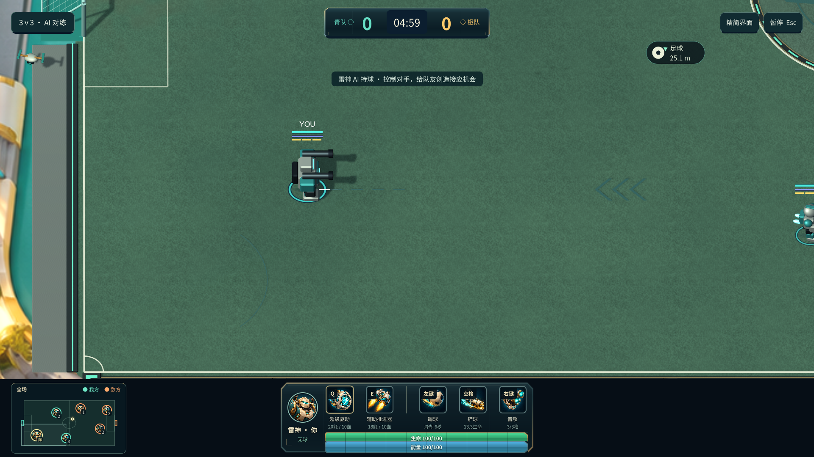
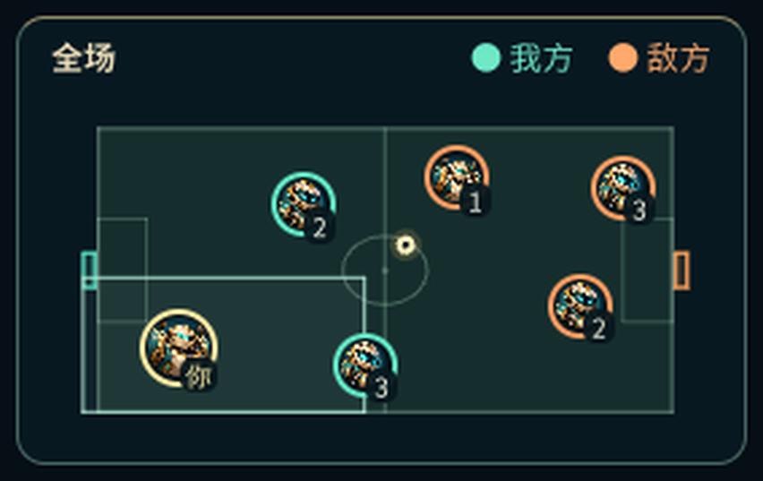

# 全场头像小地图 0.13.0

2026-10-11。在左下角增加半透明小地图，查看整个 56×34 球场。

- 双方所有角色都使用与 HUD 一致的高清头像，按真实比赛坐标实时移动。队友使用青色边框，敌人使用橙色边框；本地玩家稍大，使用暖金边框和“你”标记。数字区分队内重复角色。
- 足球无主时显示奶白色球点；持球角色头像左上角显示足球标记。击倒后头像变暗并显示叉号，保留原地位置；5 秒复活后恢复。
- 细亮框显示当前镜头在地面上的可见范围。地图方向与场上移动一致，不随角色旋转；球门、中线和开球圈直接根据规则绘制。临时技能高球仍显示地面投影。
- 完整和精简 HUD 都保留地图，同一窗口下大小一致。窗口变矮时自动缩小；完整 HUD 放在球场下方的预留空间，避开中央技能栏。所有地图元素穿透鼠标，画外足球方向提示会避让地图。
- 训练、3v3、开场热身及进球期间都显示地图；暂停时位置和镜头范围冻结。重置同步位置、球权和复活状态，换角色同步头像，退出比赛或结算时隐藏。

小地图只读取 Core 状态，不改变位置、碰撞、战斗或球权。复用 `portrait-marine-v2.png` 和 `portrait-thor-v2.png`；场地、镜头框和球点使用 UI Toolkit 网格实时绘制，头像节点按玩家复用。

## 代码入口

| 内容 | 文件 |
| --- | --- |
| 场地轮廓、头像、足球和镜头范围 | `UnityProject/Assets/Soccer/Runtime/UI/MatchMiniMap.cs` |
| 样式和透明度 | `UnityProject/Assets/Soccer/UI/Game.uss` 的 `.minimap` 样式 |
| 每帧刷新与页面切换 | `UnityProject/Assets/Soccer/Runtime/UI/GameUI.cs` |
| 画外足球提示避让 | `UnityProject/Assets/Soccer/Runtime/UI/BallLocator.cs` |
| 原生客户端检查和真实截图 | `UnityProject/Assets/Soccer/Runtime/Validation/RuntimeSmokeProbe.cs` |

## 验证与预览

132 项 Core 检查和 273 项 macOS 原生客户端检查全部通过，Mac／Windows 构建均成功且报告 0 错误、0 警告。头像实际布局误差小于 1 个屏幕像素；本轮大窗口实际尺寸为 3840×1662。

本轮验收记录：[小地图验证报告](../reports/minimap-013-validation.json)。包括真实 Core 输入推动双方头像移动、六人头像和敌我关系、足球和球权、镜头地面范围、暂停、击倒与复活、角色切换、3v3 返回训练、鼠标穿透，以及完整／精简 HUD 在 4:3、超宽和大窗口下的布局。

预览来自原生客户端截图，局部图仅裁剪和放大；动图展示由真实 Core 指令推动的测试状态，播放时间经过整理。Windows 实机运行和实体键鼠手感仍待人工试玩。
