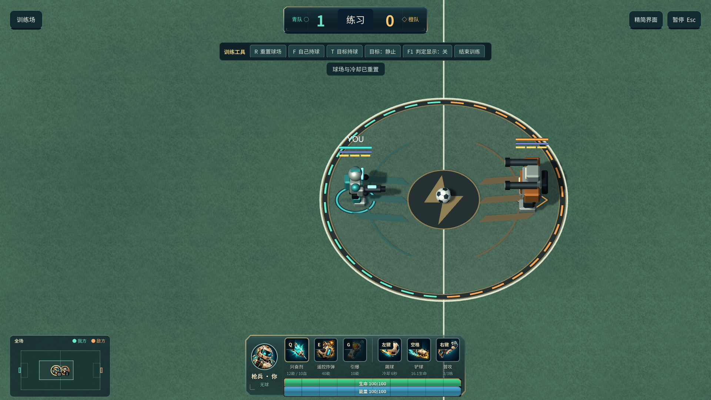

# 全屏球场 0.13.1

2026-10-11。球场铺满整个游戏窗口，取消完整技能界面下的底部黑边。

场景镜头始终使用整个窗口，不再为技能栏裁出底部 17% 的区域，同时移除填充黑边的辅助相机。半透明技能栏和左下角小地图直接叠在球场上；完整／精简 HUD 切换不改变镜头视口。局部跟随、边界限制、进球镜头、开球保护、悬停技能说明和鼠标穿透保持。

小地图仍根据实际镜头射线显示可见范围，画外足球提示会避让地图。普通比赛保持二维规则，角色和球场的立体显示保留。

| 内容 | 文件 |
| --- | --- |
| 全窗口场景镜头 | `UnityProject/Assets/Soccer/Runtime/Presentation/ArenaCamera.cs` |
| 小地图镜头范围 | `UnityProject/Assets/Soccer/Runtime/UI/MatchMiniMap.cs` |
| 视口、实际底部草地像素及原有功能检查 | `UnityProject/Assets/Soccer/Runtime/Validation/RuntimeSmokeProbe.cs` |

273 项 macOS 原生客户端检查全部通过。Mac／Windows 构建均成功，报告 0 错误、0 警告。

验证见 [本轮验收记录](../reports/fullscreen-0131-validation.json)。原生客户端检查包括实际底部无遮挡区域确实渲染草地、完整／精简界面、4:3／超宽／大窗口布局、小地图、球门庆祝镜头、技能说明和鼠标穿透。

截图来自实际 macOS 客户端。Windows 构建成功不代表 Windows 实机已验收；实体键鼠手感仍需人工试玩。
