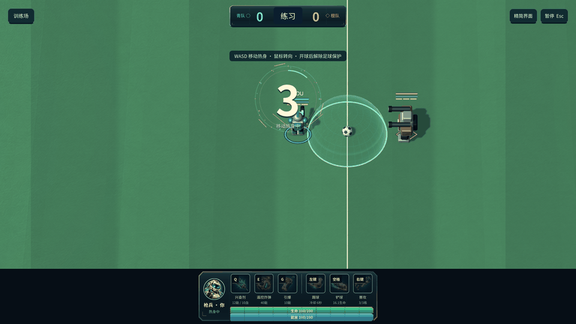

# 大球场与跟随镜头 0.10.0

2026-10-10。保护罩与球场中心圆统一大小；扩大实际地图，用局部视野给跑动留出空间。

## 当前效果

- 球场从 32×18 扩大到 **48×28**，面积约增加 **133%**。边界、球门、角球弧线、草地、图片地面与场边设施同步适配新尺寸。
- 中圈与开场保护罩统一为 **半径 2、直径 4**。地面中圈、罩体、边缘光环和 Core 阻挡使用同一数值；角色中心需停在罩体半径加自身身体半径之外。
- 镜头保持原来的斜俯视三维角度，平滑跟随本地角色，附带少量移动方向提前量。单屏只显示球场的一部分；在边线附近限制镜头范围，仍可看见球门、看台和外围布景。
- 足球离开画面时，屏幕边缘显示足球方向和距离；足球回到画面后提示消失。提示和内部元素均穿透指针，不阻挡瞄准。
- 完整技能栏保留底部 17% 屏幕空间，不叠在相机画面上。精简界面释放这部分视野。4:3 与宽屏按实际窗口适配；超宽屏将可见横向范围限制在 30 单位以内。
- 暂停冻结跟随；训练重置立即归位镜头；进球后重新开球时同步新位置。

100 生命、100 能量，踢球 6 秒与铲球 5 秒冷却、按推力反比扣血及 5 秒原地恢复均保留。常规足球继续使用二维规则，球的高度只留给特定技能。

## 调整入口

`UnityProject/Assets/Soccer/Data/PrototypeRules.asset`：`FieldWidth: 48`、`FieldHeight: 28`、`CenterCircleRadius: 2`。`OpeningShieldRadius` 是只读别名，不再提供另一份独立尺寸。默认 Core 规则与实际工程资产一致。

`ArenaCamera.cs`：基础正交半高 6.8、平滑时间常数 0.16 秒、最多 0.65 单位移动提前量；相机投影与物理坐标通过地面射线转换，瞄准仍落在真实规则平面上。

`PremiumArenaView.cs`、`DynamicStadiumView.cs`、`LivingTurf.shader`：地面图片尺寸、纹理采样、看台位置、灯牌长度、无人机、补光和球门庆祝粒子使用球场尺寸。继续使用低反射草地、细纹理和实时光照。

`BallLocator.cs`：出画足球的方向、距离和边缘位置。无需新贴图。

## 验证与证据

- **130 项 Core 检查全部通过**。新覆盖跑过旧边界、新地图角落限制、旧门线不再得分、新门线得分与外侧反弹、调整中圈尺寸后的开场保护。旧固定坐标回归场景显式保留原 32×18 尺寸。
- **172 项 macOS 原生客户端检查全部通过**，无运行错误。新增罩体与中圈投影尺寸一致、全场超出单屏、底栏独立视口、移动跟随与平滑、角落限制、出画足球提示、暂停和重置。原有技能、100 点资源、复活、倒计时、灯光、动画和 HUD 检查继续通过。
- macOS / Windows 两个构建均 `Succeeded`，0 errors / 0 warnings；macOS 包版本确认 0.10.0。Windows 实机运行、实体键鼠手感与手机尚未验证。
- 大窗口实际渲染尺寸 3840×1666；不宣称为完整 4K。

[汇总报告](../reports/large-field-010-validation.json)、[客户端报告](../reports/runtime-large-field-010/runtime-smoke.json)、[Core 报告](../reports/large-field-010-core/core-tests.json)、[源文件记录](../assets/large-field-camera-provenance.json)。

预览来自真实 macOS 原生截图。移动段每个原始截图前推进 20 个 Core tick，展示跨区域跟随；GIF 播放时间经过整理，不代表实体按键的实时手感或实际移动速度。

