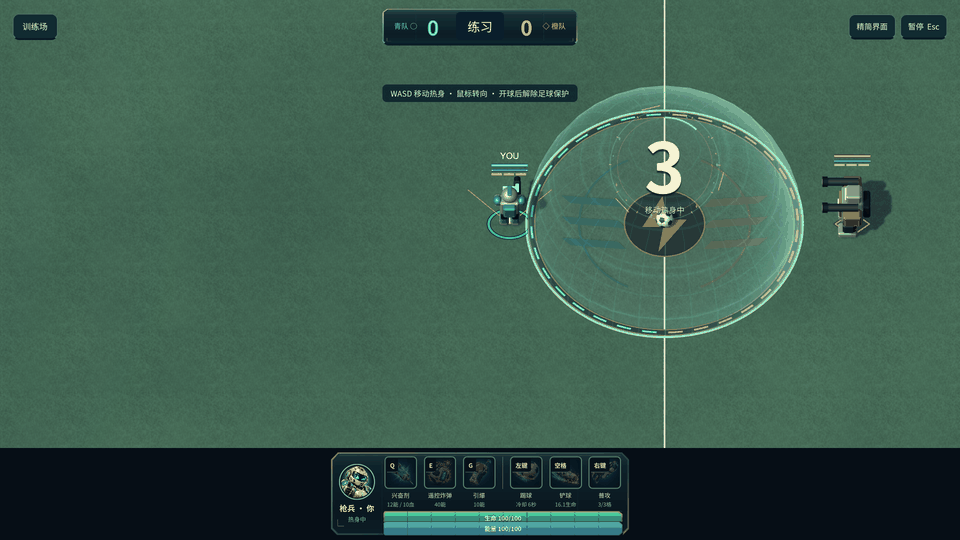

# 球场材质与中场重制 0.11.0

2026-10-10。回应局部镜头下条纹草地单调、中圈偏小、地图还需扩大的反馈。

## 画面和尺寸

- 实际球场由 **48×28 扩大到 56×34**，面积再增加约 **42%**；球门、边线、角球弧线、地面、看台、灯牌、补光和无人机随尺寸调整。继续使用局部跟随镜头。
- 中圈与开场罩体由 **直径 4 增至 8.4**，仍共用 `CenterCircleRadius=4.2`。开场前两队前排按罩体半径和角色体积外移，出生时无需被保护罩强行推出。开球后解除保护，并保留热身位置。
- 草地移除宽幅深浅绿色条纹。高清草叶素材以世界单位重复采样；四偏移混合减轻接缝与重复感，配合多尺度颜色变化、门前磨损、风动法线和哑光实时光照。
- 中场加入石墨饰圈、香槟色细边、青橙分段灯饰与双队纹章。底层和饰条分层，避免深度闪烁。中圈内继续可走动、接球、战斗。
- 球场外围增加倒角立体包边、暖灰石材步道、接缝、角部灯盖和嵌入式灯带；场内用少量低对比方向纹样区分区域。
- 角色跑动留下短暂的压草痕迹，约 5 秒消退，最多 16 个；暂停同步冻结、训练重置清除。
- 倒计时水平对齐足球的位置，避免放大镜头后挡住本地角色的生命条。

这些场地装饰均没有 Collider。100 点生命／能量、独立踢球与铲球冷却、生命消耗、原地 5 秒恢复，以及通常二维、特定技能才考虑球高的规则保留。

## 素材来源与生成

使用 **内置 `image_gen.imagegen` 工具（imagegen 技能）**生成新草叶材质，没有使用 CLI 回退。源图实际为 **1254×1254**；原始 PNG 原样复制到工程。运行时使用 mipmap、三线性采样和各向异性过滤；颜色、法线和动态压草由实时 shader 处理。

- [原始高清草地素材](../assets/original/arena/turf-detail-v4.png)
- [工程实际素材](../UnityProject/Assets/Soccer/Resources/SceneSurface/turf-detail-v4.png)
- [完整生成提示词与工具记录](../assets/crafted-arena-imagegen.json)

提示词核心：俯视、均匀曝光、无烘焙光照、密集短草叶、自然橄榄与鼠尾草色、细小踩踏和泥土变化；不绘制场地线、人物、道具和文字。生成素材保留细节，实际光照由引擎提供。

## 代码入口

| 内容 | 文件 |
| --- | --- |
| 球场尺寸与中圈半径 | `UnityProject/Assets/Soccer/Data/PrototypeRules.asset` |
| 外移开场出生点 | `UnityProject/Assets/Soccer/Core/MatchSimulation.cs` |
| 草地采样、磨损与压草 | `UnityProject/Assets/Soccer/Resources/SceneSurface/LivingTurf.shader` |
| 足迹采样、冻结与重置 | `UnityProject/Assets/Soccer/Runtime/Presentation/DynamicStadiumView.cs` |
| 场边结构、中圈纹章与饰条 | `UnityProject/Assets/Soccer/Runtime/Presentation/ArenaDetailView.cs` |
| 表面与灯带 shader | `UnityProject/Assets/Soccer/Resources/SceneSurface/ArenaInlay.shader` |
| 开球数字的投影位置 | `UnityProject/Assets/Soccer/Runtime/UI/CountdownPresentation.cs` |

## 验证

**132 项 Core 检查、181 项 macOS 原生客户端检查全部通过**。macOS 与 Windows 构建均 Succeeded，0 errors / 0 warnings；macOS 包版本确认 0.11.0。最终检查与构建结果见 [验收报告](../reports/crafted-arena-011-validation.json)。原生截图验证材质、纹章、边线、角部结构与 HUD；Core 检查验证新边界、扩大中圈后的出生位置、罩体阻挡和开球恢复。Windows 实机运行、实体键鼠手感与手机待验证。

进球球网的烟测改为观察庆祝期间出现的变形，不依赖指定截图序号；高细节截图的编码开销不再影响检查时机。此前草地条纹阶段的资料保留为历史。

预览来自真实 macOS 原生截图，移动段每个原始截图前推进 20 个 Core tick，GIF 时间经整理，不代表实体键鼠的实时速度。

实际大窗口渲染尺寸为 3840x1662，不宣称为完整 4K。

原生 1920×1080 客户端在不编码截图的 0.8 秒短采样中约为 120 FPS；该数据仅描述本机本轮短采样，不作为持续性能或跨设备保证。
