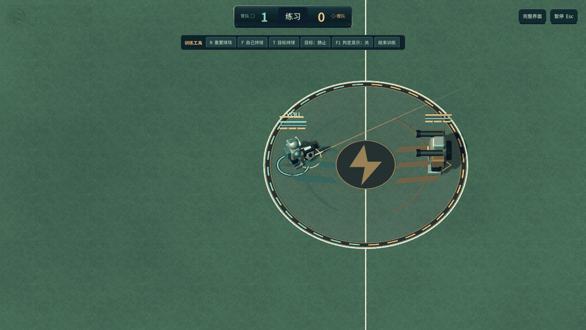

# 踢球与进球特效 0.12.0

2026-10-10。为实际比赛的踢球和进球事件增加实时三维特效。

## 踢球

- 持球蓄力时，足球周围的细线能量圈随蓄力填充，逐渐由青绿转为暖金；取消蓄力、失去球权、暂停取消和重置均会收起。
- 松开左键后出现贴地扩散的接触波、沿踢球方向的五束速度笔触和短寿命火花。轻踢与蓄力踢根据真实 Kick 事件的 Strength 区分范围、寿命、尾迹宽度和颜色。
- 自由球高速运动时，使用最近约 0.2 秒的实际渲染路径生成渐细尾迹和明亮中心线，最多 32 个采样点；能随弧线转弯，接球、低速、重新开球和重置时清理。为现有强力、弧线预备射门状态预留配色。
- 特效通过既有“比赛反馈”开关关闭，暂停同步冻结表现时间。最多保留 8 组短寿命接触爆发。

## 进球

- 得分球门上方展开 11 面彩旗，并从两侧门柱外喷出 96 片会旋转、翻折的彩纸与 12 条卷曲飘带。庆祝以青、橙队色和香槟金为主，混入珊瑚、紫、蓝等色彩。
- 彩旗、纸片和飘带由一个动态网格承载，使用双面、实时受光的材质；绳索与门线金色波纹单独绘制。效果定位在实际得分球门，并联动已有球网形变、看台欢呼和灯牌。
- 大地图中，即使本地角色仍在中场，进球阶段也会平滑看向得分球门并略微拉近；重新开球后立即恢复角色跟随。暂停时镜头和彩旗一起冻结。
- 金球或最后时刻的致胜进球先播放 2 秒庆祝，再打开结算页；Core 已立即判定结束，期间不继续推进比赛 Tick，暂停也冻结待结算时间。
- 彩旗在开球或训练重置时清理。球门庆祝属于场景反馈，精简 HUD 或关闭战斗反馈时仍可见。

这些特效没有 Collider；普通足球仍按二维规则运行，踢球冷却仍为 6 秒，铲球和战斗规则保留。未新增贴图，彩旗、纸片和飘带是运行时生成的三维网格。

## 代码入口

| 内容 | 文件 |
| --- | --- |
| 蓄力、踢球爆发与历史尾迹 | `UnityProject/Assets/Soccer/Runtime/Presentation/KickEffectsView.cs` |
| 彩旗、折纸与卷曲飘带 | `UnityProject/Assets/Soccer/Runtime/Presentation/GoalCelebrationView.cs` |
| 彩纸受光材质 | `UnityProject/Assets/Soccer/Resources/SceneSurface/CelebrationPaper.shader` |
| 实际事件接入 | `UnityProject/Assets/Soccer/Runtime/Presentation/MatchView.cs` |
| 球网、看台与庆祝联动 | `UnityProject/Assets/Soccer/Runtime/Presentation/DynamicStadiumView.cs` |
| 致胜进球庆祝后结算 | `UnityProject/Assets/Soccer/Runtime/Application/AppController.cs` |
| 进球镜头与开球恢复 | `UnityProject/Assets/Soccer/Runtime/Presentation/ArenaCamera.cs` |

## 验证与预览

132 项 Core 检查、207 项 macOS 原生客户端检查全部通过。检查包括轻踢／蓄力强度、取消蓄力、二维球高、尾迹数量上限、两侧进球的实际事件、精简／完整 HUD 镜头边界、暂停冻结、开球恢复与训练重置清理，以及金球结束后的庆祝、暂停与结算。构建状态与完整证据见 [本轮验收报告](../reports/football-fx-012-validation.json)。

预览来自真实 macOS 原生渲染截图。烟测暂停比赛时钟，以真实踢球／进球事件和受控步进准备展示状态；GIF 播放时间经整理，不代表实体键鼠的实时速度。Windows 实机运行和实体键鼠手感仍待人工试玩。

