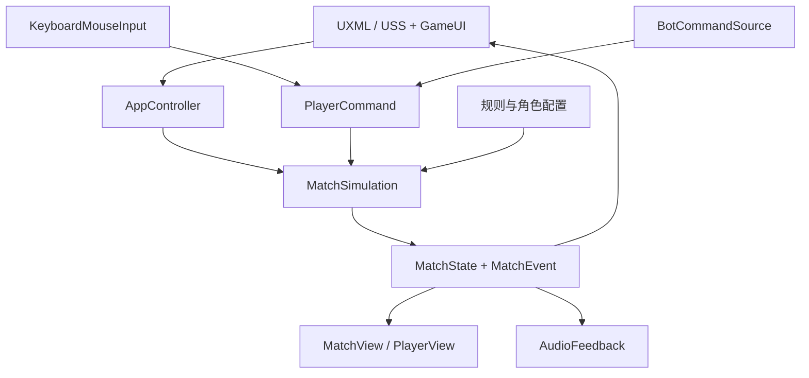
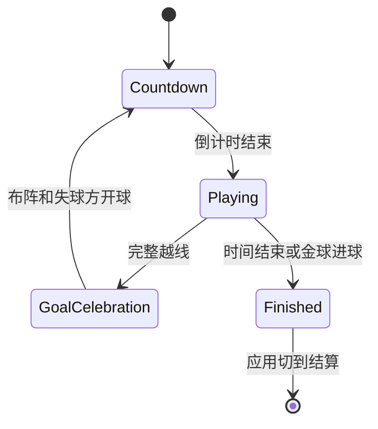

> **0.22.0 选人和教程（2026-10-13）**：`MatchDraft` 管理六人交替选人、位置限制与超时；`NetworkDraft` 由房主校验当前玩家和轮次，复制选人状态，六人完成后发送阵容与位置。`AppDraft`／`DraftUI` 编排每局第一阶段，`TrainingLesson` 设置正常规则下的练习场景，`TutorialSession`／`TutorialUI` 根据真实命令、事件与状态判断完成。`AppPage.PlayMenu` 先选择模式。联机协议为 `SkillSoccer/0.22.0/5`，同局使用相同版本。详见 [更新说明](模式选人与新手教程0.22.0.md)。

> **0.17.1 调试帐号（2026-10-12）**：`DebugAccounts` 提供公开 a/a、b/b 身份，客户端登录后在房间握手接受房主随机挑战校验；帐号密码与可选房间口令独立。`AppNetworking` 保管进程内会话，`NetworkUI` 提供登录／退出和房间帐号显示。步骤见 [Windows 联机验证](调试帐号与Windows联机验证0.17.1.md)。

> **0.17 联机更新（2026-10-12）**：`Core/Networking` 新增实际 TCP 房间和 UDP 发现；房主 60 Hz 模拟、客户端 20 Hz 快照插值，支持互联网密码、角色队伍、准备、AI 补位、离开和重开。`AppNetworking`／`NetworkUI` 编排新页面，所有本地 HUD 和镜头读取 `LocalPlayerId`。以下“没有网络协议”和“联机不可用”属于历史阶段，当前入口见 [联机说明](局域网与互联网联机0.17.0.md)。

> **0.4 战斗更新（2026-10-09）**：新增 `CombatLoadout`／`CombatSystem`。默认 `MatchRules.EnableCombat=true`，装备与英雄分离；旧角色 ID 和文件名保留以兼容引用。生命、能量、普攻前摇、护盾、加速、复活与弹体只由 Core 写入。`MatchSimulation` 在所有未结束比赛阶段推进死亡等待，物理子步顺序为技能物、移动、战斗、足球；进球重开跳过仍倒地的角色。详见 [当前玩法与验证入口](./合作乱斗玩法原型.md)。

> 当前规则与设计以 [最初设计文档](游戏设计文档.md) 的 0.14.0 汇总为准，包含当前两角、56×34 球场、全屏跟随镜头、头像小地图、双资源 UI 与上下半场。本文早期阶段记录保留参考。

# 技能足球 · 项目架构与开发指南

**当前 0.8**：枪兵与雷神采用双角色配置，3v3 允许重复角色并保持双方角色数量相同。`StarStrikerSkills` 结算参考技能，普通武器沿用 `CombatSystem`；新增独立踢球冷却与铲球生命消耗。详见 [枪兵与雷神玩法原型](./枪兵与雷神玩法原型0.8.md)。下方 0.7.1 说明保留二维与高度约定，其三角色与待定技能描述属于历史。

**0.7.1 规则修正**：常规玩法全部使用二维规则，三维球体、球门和实时光照用于显示。`BallFlightMode` 只为未来特定越顶技能启用临时高度，第一次落地立即回到二维；进球、门柱和墙始终按平面判定。通用挑球输入与训练入口已移除，现有角色没有启用越顶技能。详见 [二维规则与技能高球](./二维规则与技能高球0.7.1.md)。下面原始 0.3 架构说明与后续更新共存。

2026-10-09 · 原型 0.3 · 团结引擎 1.10.4 / C#

本轮用户已授权开始项目，优先要求 UI 与游戏逻辑清晰，便于继续开发。工程交付范围为 PC 离线训练和三角 AI 对练；设计文档 v0.7 是功能依据。未确认的规则使用配置中的原型值，不升级为正式设计决定。

## 1. 先读这些入口

1. 打开 `UnityProject/Assets/Soccer/Scenes/Prototype.unity` 试玩。
2. 阅读 `AppController.cs`，理解页面和对局生命周期。
3. 阅读 `MatchSimulation.cs` 的 `Step()`，理解一帧规则执行顺序。
4. 要修改具体行为，再打开相应 System 或技能文件。
5. 要调整界面，打开 UXML/USS 与 `GameUI.cs`，无需读物理代码。

## 2. 目录与依赖

```text
UnityProject/
  Assets/Soccer/
    Core/                    纯 C# 规则和机器人，无 Unity 引用
      Skills/                每种角色单独实现技能
    Runtime/
      Application/           页面与对局编排
      Input/                 键鼠输入适配
      Data/                  ScriptableObject 类型与配置转换
      Presentation/          投影、精灵、特效与音效
      UI/                    界面事件绑定与数据展示
      Validation/            通过启动参数启用的客户端检查
    Data/                    比赛、角色、动画配置资产
    UI/                      UXML、USS、面板和中文字体资产
    Art/                     本阶段选用美术及来源记录
    Audio/                   原有 Kenney CC0 兼容音效与许可证
    Resources/SoccerAudio/   原创音乐/技能/比赛/UI 音效与生成索引
    Scenes/                  可编辑的入口场景
    Editor/                  资源导入、初始化、构建工具
  Packages/                  固定依赖及锁定文件
  ProjectSettings/           引擎版本和项目设置
tests/Soccer.Core.Tests/      直接编译同一套 Core 源码的规则测试
tools/                       引擎入口、素材准备与原有工具
reports/                     测试、构建报告及客户端截图
```



三个程序集明确边界：`Soccer.Core` 不引用引擎，`Soccer.Runtime` 引用 Core，`Soccer.Editor` 只在编辑器使用。Core 的状态属性只有程序集内部可写，UI 和渲染层不能直接改球权、比分或冷却。

## 3. 各模块职责

| 文件 / 类型 | 做什么 | 修改场景 |
| --- | --- | --- |
| `MatchRules` | 比赛与基础动作数值、启动检查 | 改角度、时长、球速、保护时间 |
| `CharacterStats` | 角色属性及本轮技能调参字段 | 调三名角色差异 |
| `PlayerCommand` / `ICommandSource` | 输入意图和输入提供者协议 | 新增输入方式 |
| `MatchState` | 比赛、角色、足球、技能物、事件 | 新增可同步状态 |
| `MatchSimulation` | 生命周期、时钟、开球、固定步调度、统计 | 改比赛流程 |
| `MovementSystem` | 普通移动、突进、推移、身体分离 | 调整移动与阻挡 |
| `TackleSystem` | 接触角、抢断、推人、各类保护 | 调整夺球分支 |
| `BallSystem` | 蓄力、释放、控球、扫掠碰撞、进球 | 修改球路或持球 |
| `Skills/*Skills` | 单角色 Q/E 行为 | 新增或替换技能 |
| `SkillSystem` | 技能物的预警、寿命、护板重叠修正 | 共通技能物行为 |
| `BotCommandSource` | 基础跑位、接球、射门和抢断 | 改训练 AI |
| `AppController` | 页面、创建模拟、暂停、输入源组合 | 新模式入口或流程 |
| `KeyboardMouseInput` | 采样键鼠，积累尚未消费的按键边沿 | 重映射、接 Input System |
| `GameUI` | 绑定控件、读取状态、刷新 HUD | 新按钮和展示字段 |
| `MatchView` / `PlayerView` | 视觉投影、排序、动画、预览线 | 新美术、特效、动画 |
| `ProjectSetup` | 导入精灵、生成初始资产、构建 | 资源工作流、构建平台 |

## 4. 一次对局和一帧输入

`AppController.StartMatch()` 将规则与角色 SO 拷贝成独立的 Core 配置，创建 `MatchSimulation`，分配输入提供者，再绑定视图。运行中的模拟使用自己的配置副本；修改 Inspector 后重新开局生效。

模拟固定为 60 Tick/s，客户端目标渲染/输入采样为 120 fps。渲染帧先采样输入，按累计时间推进 Tick，最后用上一 Tick 与本 Tick 的位置插值显示。一个渲染帧可能对应零个、一个或多个 Tick，所以按下/松开边沿先累积，第一次消费后清空；持续移动和瞄准保留。每帧最多补进 0.1 秒，当前是本地原型的卡顿保护，不能直接用作服务器时间策略。

`MatchSimulation.Step()` 的执行顺序：

1. 清理上一 Tick 的事件，记录上一位置。
2. 处理倒计时和庆祝；只有 Playing 推进有效比赛时间。
3. 更新冷却、控制和保护；先处理右键取消与已有控制状态。
4. 读取朝向及抢断、技能、踢球输入。
5. 一个 Tick 默认分 4 个物理小步，依次更新技能物、角色移动/抢断接触、足球运动/接球/进球。
6. 更新有效时钟，处理加时和结束；结束事件由应用层切到结算页。
7. 应用层立即消费当次 `Events`，播放音效、显示提示；不能等下个 Tick 才读取。

暂停属于本地应用流程：不调用模拟 `Step()`，清空输入边沿和累计时间。失去窗口焦点自动暂停。恢复后需要重新按键开始蓄力，防止菜单操作或失焦后的松键泄漏到比赛。

## 5. 状态和规则

### 比赛状态



训练不倒计有效时长，由用户结束。AI 对练默认 300 秒；平局进入 90 秒金球加时，仍平局就结束。开局自由球，中途进球后由失球方轮换开球者。重置清除场上技能物和临时效果，双方冷却同样重置。

### 足球和持球

足球只保存一个 `OwnerId`，`-1` 表示自由球。持球时脚前距离为角色半径＋球半径＋0.05 u，持球移速 ×0.92。射门基础初速从 9 到 18 u/s，角色踢距系数按平方根修改初速；恒定减速 8 u/s²。

普通接球速度门槛 10 u/s，高速球撞身体后反弹。自己踢出的球 0.25 秒内不能重新接住。球与墙、门柱、护板和身体使用路径扫掠，寻找该段最早接触，反弹后继续走剩余路径。球门必须完整越线才计分，计分立即锁定当前回合，持球也参与进球判定。

### 抢断和推移

首次实际敌方身体接触才计算夹角。原型采用 A 解释：锁定突进方向与指向被撞目标中心的夹角 ≤45°，完整扇形 90°。目标朝向不影响这一版本。

| 条件 | 结果 |
| --- | --- |
| 持球敌人、角度合格 | 转移球权，短硬直，新持球者短暂防重复夺球 |
| 持球敌人、角度超限 | 推移，保留目标球权，打断蓄力 |
| 无球敌人 | 推移 |
| 完整接触保护 | 不转球权、不推移 |
| 防重复夺球保护且角度合格 | 不转球权，不改判成推移 |
| 重复硬控保护 | 可以合法夺球，本次不附加硬直或推移 |
| 没有身体接触 | 空挥，不能远程夺球 |

角度在 `TackleSystem.ContactAngle()` 中计算；调角度修改 `PrototypeRules.asset` 的 `TackleAngleDegrees`。若改为“以被撞者朝向为参照”，应更换角度策略和测试，不能只改数值。

### 三名角色

本轮已实现风梭的接力/侧滑/顺风带、铁卫的固有抗推/护板/扎根、弧光的踢距差异/弧线准备/重炮准备。每个技能各自有校验和冷却。风梭 E 用按住预览、松开确认；右键取消不消耗冷却。弧光准备必须持球，后施放的准备替换前一个，旧冷却不返还。

AI 当前完成基础跑位、持球推进、蓄力射门、抢断，约每 0.18 秒重新决策。未实现策略传球和主动技能选择；已提供输入源接口，后续添加行为时仍提交 `PlayerCommand`。

## 6. 配置和资源修改方法

比赛配置位置：`UnityProject/Assets/Soccer/Data/PrototypeRules.asset`。角色配置位置：同目录三名角色的 `.asset`。

| 调整项 | 字段 |
| --- | --- |
| 场地与门口 | `FieldWidth`、`FieldHeight`、`GoalWidth`、`GoalDepth`、`PostRadius` |
| 比赛时间 | `MatchSeconds`、`OvertimeSeconds`、各个 Countdown / Celebration 字段 |
| 接球和射门 | `CatchSpeed`、`BallDeceleration`、`TapKickSpeed`、`FullKickSpeed`、`ChargeSeconds` |
| 抢断和控制 | `Tackle*`、`Push*`、`ControlProtection`、`StealProtection` |
| 角色基本属性 | `Speed`、`Radius`、`KickDistance`、`PushResistance` |
| 风梭技能 | `QDistance`、`QDuration`、`Lane*`、`Relay*`、Q/E 冷却 |
| 铁卫技能 | `Shield*`、`QWindup`、`QDuration`、`Root*`、`EDuration`、Q/E 冷却 |
| 弧光技能 | `PreparationLifetime`、`Curve*`、`Power*`、Q/E 冷却 |

角色配置里的 `Role` 和 Q/E 说明是面向玩家的文字；调整技能数值时同步调整说明。当前公共 `CharacterStats` 中也有其他角色的调参字段，只有本角色实现引用的字段生效，详见上表。

注意：逻辑几何可调，但球场标线和球门插画目前仍是 32×18 u 的源稿。改变尺寸后必须同时重建视觉几何，不能靠拉伸角色图来适配。3v3 阵型目前在 `ResetPositions()` 明确组装；增加人数需要修改阵容、开球槽轮换和 AI 站位，不存在已经完成的动态 4v4 模式。

原图保存在仓库外层 `assets/`，工程只导入本阶段选用部分。`prepare_unity_assets.py` 写出导入计划，`ProjectSetup.ImportAnimations()` 使用 Sprite Editor 数据提供者按真实矩形、Pivot 和统一 PPU 创建精灵，保留已有帧的 Sprite ID，避免再导入破坏引用。精灵实际切帧存进 PNG `.meta`；动画银行 SO 保存帧顺序和帧率。

投影由 `ArenaProjection` 统一转换：逻辑 Y ×sin(55°) 显示，物理尺寸不压缩。人物不旋转、不镜像；按逻辑 Y 排序。跑步与踢球只在已有 SE 方向播放，其他方向用八向转身姿态；这只是方向动画缺失时的临时显示策略。

UI 使用 UXML/USS 和运行时 UIDocument，结构与行为分离；接入方法依据 [Unity 2022.3 运行时 UI 文档](https://docs.unity3d.com/2022.3/Documentation/Manual/UIE-get-started-with-runtime-ui.html)。中文使用 Noto Sans CJK SC 的 TextCore 字体资产，USS 指定 `-unity-font-definition`，详见 [Unity 字体资产说明](https://docs.unity3d.com/cn/2022.3/Manual/UIE-font-asset-landing.html)。

## 7. 继续开发的约定

- 规则不得写入 UI 按钮、精灵碰撞回调或动画事件；新增行为放进 Core，交互层提交命令。
- 每个角色单独一个技能实现；新增角色时同时新增配置、动画银行、角色选择入口和规则验证。
- 真正的技能距离/寿命在配置中，预览与技能效果读取同一数值。
- 不要使用 Unity `Time`、随机全局状态、GameObject 或物理引擎对象处理球权；纯规则由固定 Tick 输入驱动。
- 改动球权、保护、门线和结算时，运行对应规则测试；单纯改 UI 间距用实际截图和交互检查。
- 提交 `Assets/`、`Packages/`、`ProjectSettings/` 和所有 `.meta`；不提交 Library、Builds、obj/bin。
- 初始化工具保留已有配置和场景；更新美术时保留原始源稿和来源记录。

## 8. 联机接口和当前边界

`PlayerCommand`、`MatchState` 和 `MatchEvent` 给联机阶段提供清晰接口，但目前没有网络协议、快照编码、校正或预测。浮点模拟、顺序身体分离、技能扫掠的近似方法与本地事件列表，不能声称满足跨平台确定性或服务器安全要求。

当前同步时间策略、移动身体之间的相对连续碰撞、同 Tick 多技能与松键的精确时间裁决、回合优先级公平性，需要在 M3 重新验证。护板用胶囊圆采样近似；正式实现可更换为精确线段扫掠。完整接触保护已用于开球，回响护罩接入时需扩充主动技能解除逻辑。

M3 应先为每名玩家命令添加 Tick/序号、实现受控快照及事件序号、拆出权威端接收验证，再做预测和状态恢复。Steam、排位与后端应使用实际验证过的比赛结果，不直接信任客户端结算页。

## 9. 手感与音频 0.2

Core 增加 `PlayerActionBuffer`，每名球员分别保存短期动作意图，`MatchSimulation` 只在动作成功可执行后消费，暂停/控制/重置清除。比赛事件补充技能槽位、射门准备/强度和反弹位置。`AudioFeedback` 管理音乐淡化、12 个有优先级的比赛声音通道、UI 和蓄力；`MatchView`/`PlayerView` 负责即时瞄准、球路参考、闪光和扩散效果。入口、数值、音频来源及复现见 [操作手感与音效](./操作手感与音效.md)。

## 10. 启动与模式入口 0.3

前端新增 `AppPage.Loading` / `ModeDetails`，启动阶段预加载真实音频资源后进入三种模式选择。`GameModeCatalog` 的前端玩法枚举与 Core 离线模式分离；详情页通过 `ConnectionRoute` 表达互联网/LAN，当前联机操作不可用。来源选角返回、响应式规则、素材与未来接入位置见 [启动与模式选择 UI](./启动与模式选择UI.md)。
